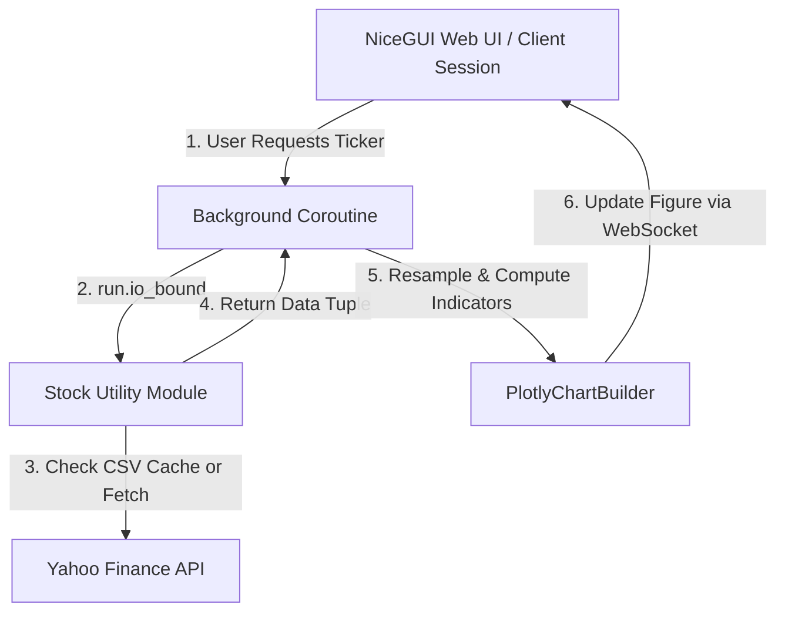

# Stock Chart App: Deep Dive & Algorithm Analysis

This document explains the core financial engineering, caching, and chart layout algorithms implemented in the NiceGUI + Plotly Stock Chart application.

> **Related**: See [design.md](../design.md) for system architecture, sequence diagrams, and class models.

## 1. System High-Level Architecture

The application uses an asynchronous **AsyncIO + Worker Thread Pool** architecture powered by NiceGUI (`run.io_bound`) so network I/O and pandas aggregation never block the WebSocket UI loop.

## 2. Algorithm: Smart Incremental Data Caching
**File**: `app/stock_util.py` -> `fetch_stock_data_with_cache`

1. **Input**: `ticker` (e.g., `"SPY"`), `interval` (`1m`, `5m`, `1h`, `1d`).
2. **Cache Lookup**: Scans `app/csv/{ticker}_{interval}_*.csv` sorted by newest modification timestamp.
3. **1-Minute Intraday Branch (`interval == '1m'`)**:
   - Requests a rolling 5-day buffer (`period="5d"`, `prepost=True`) to avoid overnight/weekend gaps.
   - Merges with any cached intraday bars, deduplicates on the Eastern-time index (`keep='last'`), and writes an updated cache file.
4. **Daily / Hourly Incremental Branch**:
   - **Cache Miss**: Fetches full history (`2000-01-01` for `1d`, last `700` days for `1h`, last `55` days for `5m`).
   - **Cache Hit**: Checks `last_date_str <= today_str` and downloads only the delta from `last_date_str` forward. Same-day refreshes replace the latest daily candle as its OHLCV values change.
   - **Stock Split Detection**: If `Stock Splits > 0` appears in the delta window, discards the stale cache and triggers a full redownload to preserve price continuity.
5. **Metadata Sidecar (`{ticker}_info.csv`)**: Caches company/ETF fundamentals locally for 30 days.

## 3. Algorithm: Visual Gap Filling (1m Intraday Smoothing)
**Files**: `app/app_stock_chart.py` -> `_apply_resampling`, `app/chart_plotly.py` -> `build_figure`

1. Calculates indicators on observed bars after applying the selected market-hours filter, without inserting overnight or weekend bars.
2. Reindexes only the displayed trading session onto its fixed 1-minute grid.
3. Forward-fills `close` and missing OHLC values between that session's first and last trades to render flat Doji ticks, setting synthetic volume to zero.
4. Leaves minutes before the first trade and after the last trade empty. Display-only synthetic bars never feed back into indicator calculations.

## 4. Algorithm: Gapless Financial X-Axis & Backtrack Collision Resolution
**File**: `app/chart_plotly.py` -> `_compute_date_ticks`

1. **Index-Based Plotting**: Maps N trading bars onto consecutive integers `[0, 1, ..., N-1]` so weekends and market closures produce zero horizontal empty gaps.
2. **Priority Label Placement & Collision Backtracking**:
   - Iterates chronologically over bar timestamps.
   - Enforces minimum bar spacing (`MIN_COLLISION_GAP = 6` for `3M/6M`, `10` for `1Y+`, `8` for hourly views).
   - When a high-priority boundary label (such as the start of a new month or year) collides with an immediately preceding low-priority day tick, the algorithm **retroactively pops** the lower-priority tick so major time boundaries always anchor the axis cleanly.

## 5. Algorithm: Vectorized Right/Left Horizontal Volume Profile
**File**: `app/chart_plotly.py` -> `_compute_volume_profile`

1. Partitions `[low.min(), high.max()]` into `N` equal price bins (`100`, `200`, or `400` bins).
2. Maps every candle's `[low, high]` span to `[start_bin, end_bin]` and distributes its `volume` uniformly across the spanned bins.
3. Renders the resulting horizontal bar histogram (`go.Bar(orientation='h')`) on an overlaid secondary X-axis (`xaxis9`) sharing the primary price Y-axis (`yaxis='y'`), reversing `xaxis9` (`[max_vp * 4, 0]`) when anchored to the **Right** edge.

## 6. Algorithm: Custom Multi-Day & Time Resampling
**File**: `app/stock_util.py` -> `resample_data`

- **Trading-Day Grouping (`2D`, `3D`)**: Groups consecutive trading sessions by integer quotient (`index // n_days`) so holiday weeks never produce partial 1-day bars, recording `period_start` for accurate date ranges in the readings frame.
- **Calendar Resampling (`10min`, `W-MON`, `MS`)**: Uses left-labeled OHLCV aggregation (`open='first'`, `high='max'`, `low='min'`, `close='last'`, `volume='sum'`).

## 7. Algorithm: Synchronized Crosshairs & Movable Readings
**Files**: `app/chart_plotly.py`, `app/chart_interactions.py`, `.js`, `.css`

1. The figure includes `layout.meta.stock_chart` with the displayed dates, OHLCV, enabled moving averages, indicator series, and current subplot-axis mapping. Missing values are serialized as JSON `null`.
2. Browser pointer coordinates are converted through the active Plotly axes, using their current offsets and scales after panning or resize. The nearest integer X coordinate selects the same trading bar in all panes.
3. An SVG overlay draws a vertical line in each enabled pane. Only the active pane receives a horizontal line and a left-axis label, which shows the pointer's height in that pane's units.
4. A draggable frame always displays the selected bar's OHLCV. Price-pane hover adds enabled moving averages; MACD/RSI hover adds only that indicator's readings. Empty intraday minutes show missing values.
5. Pointer updates are batched with `requestAnimationFrame`. Plot redraws refresh the metadata and axis mapping while retaining the frame position; unmounting removes listeners and observers.

## 8. Algorithm: Fixed-Width History Navigation

1. Full resampled history and its indicator warmup remain in the chart. The selected time window determines a fixed count of visible trading bars. A 1D chart retains separate minute grids for earlier sessions, with gap filling confined to each session.
2. Dragging and horizontal wheel events move the viewport without changing its width. The left edge is clamped between the earliest loaded bar and `total_bars - visible_bars`, so gestures cannot reveal empty space beyond the available history.
3. The browser updates all pane X ranges together. It fits price and MACD ranges to visible bars, scales the volume overlay, and recomputes the volume profile from the raw bars represented by that same viewport. Profile metadata maps each displayed bar to the corresponding raw-data slice.
4. After the gesture settles, a `history` event sends the starting bar and dataset context to Python. The controller ignores stale contexts, commits the viewport, and rebuilds the figure and title. Moving averages and indicators retain their full preceding history.
5. Native Plotly selection, zoom, double-click autoscale, and axis-range editing are disabled. Image export remains available. Auto-refresh runs only while the viewport follows the latest data.

## 9. Algorithm: Logarithmic Price Display

1. `log_scale` defaults to `false` and is saved with the other chart preferences. The checkbox switches the price Y-axis between `linear` and `log`; the underlying OHLC, SMA, Bollinger Band and volume-profile price values are unchanged.
2. Both Python and browser-side visible-range fitting discard nonfinite/nonpositive price levels in log mode, convert the remaining values to log10, and add padding in those coordinates. Plotly receives exponent ranges and original price data.
3. MACD, RSI and the separate volume axis retain their normal scales. Crosshair mapping converts a logarithmic price coordinate back with `10 ** coordinate`, so the axis label still reports an actual price.
4. The selected history window survives scale changes. The navigation context and Plotly revision include the scale, preventing pending updates from applying the previous scale's bounds.
