# DIY Stock Chart — Desktop Architecture and Browser Modernization

> Original desktop design created with Anti Gravity (Claude Opus 4.6 Thinking). Documentation expanded on 2026-11-17.

> **Scope and status:** Sections 1–4 and the desktop reference tables describe the Tkinter/Matplotlib source currently published under `chart-app/`. Section 5 adds the separately implemented NiceGUI/Plotly modernization reference design, including HLD, LLD, interaction contracts, data ownership and verification. The browser rewrite is not yet present in this public source tree.

> **Reading guide:** Existing PlantUML sources and PNGs remain desktop architecture artifacts. New Mermaid diagrams belong to the labeled browser chapter. Preserving both records shows the architecture evolution without presenting an unpublished implementation as available from this checkout.
> See also: [Algorithm Deep-Dive](chart-app/algorithm.md) · [README](readme.md)

---

## Table of Contents

1. [High-Level Design (HLD)](#1-high-level-design)
   - 1.1 [System Overview](#11-system-overview)
   - 1.2 [Key Design Principles](#12-key-design-principles)
   - 1.3 [Component Architecture](#13-component-architecture)
   - 1.4 [Threading & Concurrency Model](#14-threading--concurrency-model)
   - 1.5 [Data Flow — Startup Sequence](#15-data-flow--startup-sequence)
   - 1.6 [Data Flow — Data Acquisition](#16-data-flow--data-acquisition)
   - 1.7 [Technology Stack](#17-technology-stack)
2. [Low-Level Design (LLD)](#2-low-level-design)
   - 2.1 [Class Diagram](#21-class-diagram)
   - 2.2 [Module-by-Module Method Breakdown](#22-module-by-module-method-breakdown)
   - 2.3 [State Management Model](#23-state-management-model)
   - 2.4 [Caching & Persistence Strategy](#24-caching--persistence-strategy)
   - 2.5 [Rendering Pipeline](#25-rendering-pipeline)
   - 2.6 [Interaction Flow — Window Change](#26-interaction-flow--window-change)
   - 2.7 [Interaction Flow — Resampling Pipeline](#27-interaction-flow--resampling-pipeline)
   - 2.8 [Interaction Flow — Crosshair](#28-interaction-flow--crosshair)
3. [Data Model](#3-data-model)
   - 3.1 [Entity-Relationship Diagram](#31-entity-relationship-diagram)
4. [Cross-Cutting Concerns](#4-cross-cutting-concerns)
   - 4.1 [Logging](#41-logging)
   - 4.2 [Error Handling](#42-error-handling)
   - 4.3 [DPI Awareness](#43-dpi-awareness)
   - 4.4 [Performance Considerations](#44-performance-considerations)
5. [Browser Modernization Reference Design](#5-browser-modernization-reference-design)
   - [Scope and evidence](#51-scope-and-reading-guide)
   - [C4 architecture](#53-c4-architecture)
   - [Detailed interaction flows](#55-flow-inventory-and-source-to-flow-ledger)
   - [Low-level contracts](#56-low-level-component-contracts)
   - [Data and configuration](#59-persistence-data-model-and-configuration)
   - [Verification and source map](#512-verification-and-source-map)

---

## 1. High-Level Design

### 1.1 System Overview

The DIY Stock Chart App is a single-process, multi-threaded Python desktop application that provides interactive financial charting with technical indicators. It follows a **Producer-Consumer** architecture where network I/O is offloaded to background threads while the UI thread remains responsive.

The system is composed of five Python modules:

| Module                  | Role                                      | Primary Class / Functions          |
| :---------------------- | :---------------------------------------- | :--------------------------------- |
| `app_stock_chart.py`    | Application shell & orchestrator          | `StockChartApp`                    |
| `chart_drawing.py`      | Rendering pipeline & mouse interaction    | `ChartPlotter`                     |
| `stock_util.py`         | Data acquisition, caching, indicators     | Module-level functions             |
| `info_panel.py`         | Floating fundamental-data overlay         | `InfoPanel`                        |
| `watchlist.py`          | Watchlist persistence & management UI     | `WatchListManager`, `WatchListUI`  |

A sixth file, `debug_price.py`, is a standalone CLI tool for data-quality analysis and is not part of the main application runtime.

### 1.2 Key Design Principles

| Principle                           | Implementation                                                                                     |
| :---------------------------------- | :------------------------------------------------------------------------------------------------- |
| **Responsive UI**                   | Network I/O runs on daemon threads; results arrive via `queue.Queue`; UI polls with `root.after()` |
| **Zero external databases**         | All persistence uses flat CSV files under `csv/` and `conf/`                                       |
| **Incremental data loading**        | Daily/hourly cache is appended rather than re-downloaded                                           |
| **Gapless financial charting**      | Integer-index plotting with custom label formatters eliminates weekend/holiday gaps                 |
| **Global asset awareness**          | The app groups Crypto, Forex and Futures into a calendar-day display model rather than equity hours; this is not an exchange-calendar guarantee      |
| **Settings persistence**            | All UI toggle states survive across sessions via `conf/settings.json`                              |

### 1.3 Component Architecture

📄 [PlantUML Source](design-diagram/01-component-architecture.puml)

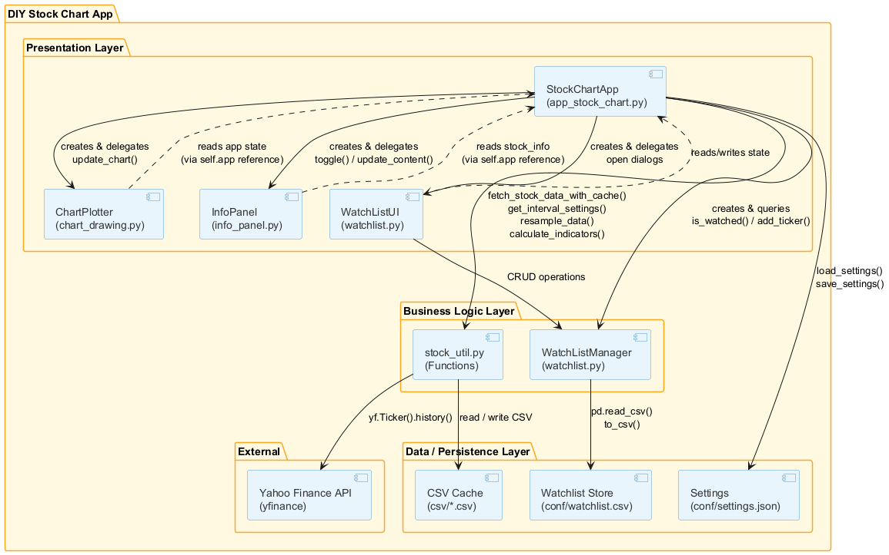

### 1.4 Threading & Concurrency Model

📄 [PlantUML Source](design-diagram/02-threading-concurrency.puml)

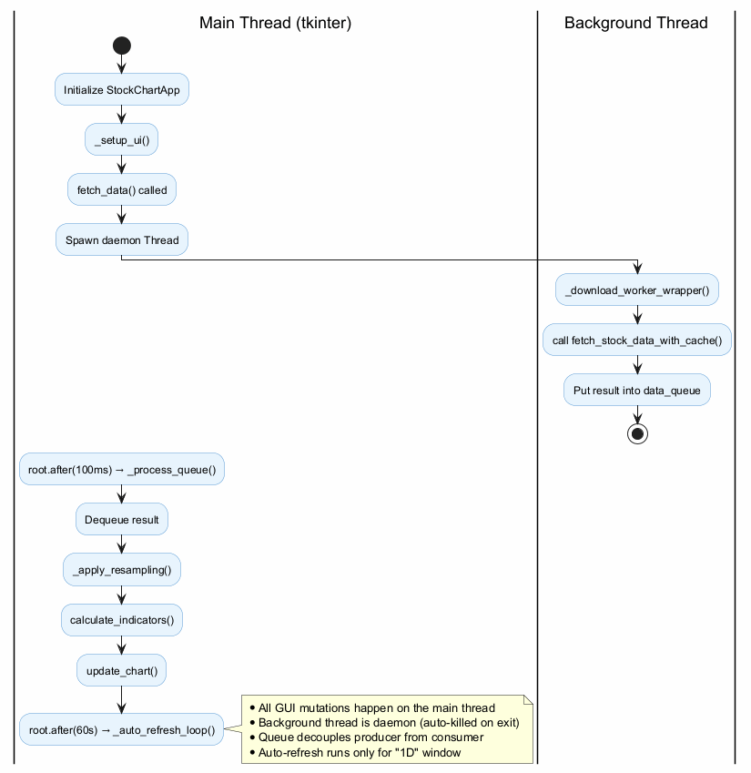

**Concurrency rules**:
- The `queue.Queue` is the sole communication channel between threads.
- The background thread writes to the queue; the main thread reads.
- `_process_queue()` is polled every **100 ms** via `root.after(100, ...)`.
- `_auto_refresh_loop()` fires every **60 s** but only re-fetches when `auto_refresh` is `True` and window is `"1D"`.
- All `tk` / `matplotlib` API calls occur exclusively on the main thread.

### 1.5 Data Flow — Startup Sequence

📄 [PlantUML Source](design-diagram/03-startup-sequence.puml)

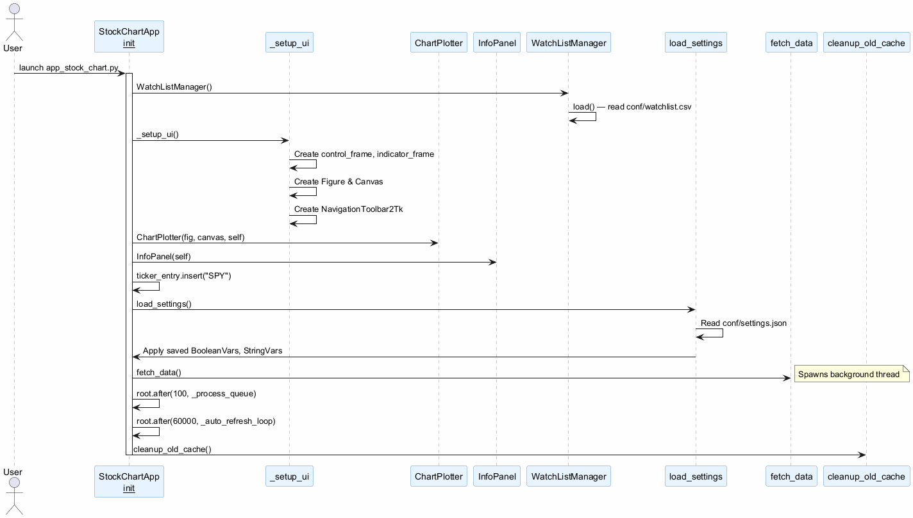

### 1.6 Data Flow — Data Acquisition

📄 [PlantUML Source](design-diagram/04-data-acquisition.puml)

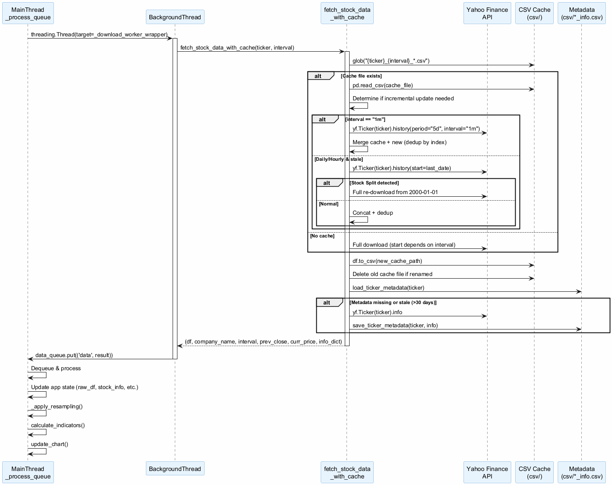

### 1.7 Technology Stack

| Layer           | Technology                                     | Version / Notes                      |
| :-------------- | :--------------------------------------------- | :----------------------------------- |
| Language        | Python                                         | Desktop notes report 3.13.2; not rerun in this update                     |
| GUI Framework   | `tkinter` + `ttk`                              | Stdlib                               |
| Charting        | `matplotlib` (+ `FigureCanvasTkAgg`)           | Embedded in tkinter                  |
| Data Fetching   | `yfinance`                                     | Unofficial Yahoo Finance API wrapper |
| Data Processing | `pandas`, `numpy`                              | DataFrames, rolling windows          |
| Indicators      | `finta` (TA library)                           | MACD, RSI, Bollinger Bands           |
| Persistence     | Flat CSV + JSON files                          | No database                          |
| Platform        | Windows 11                                     | DPI awareness via `ctypes`           |

---

## 2. Low-Level Design

### 2.1 Class Diagram

📄 [PlantUML Source](design-diagram/05-class-diagram.puml)

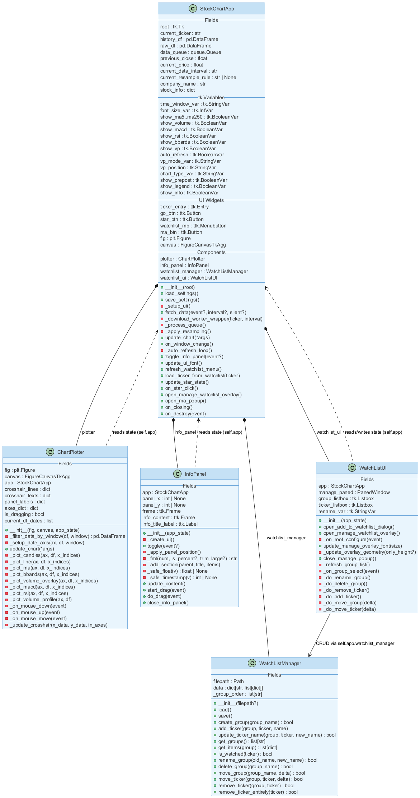

### 2.2 Module-by-Module Method Breakdown

#### 2.2.1 `app_stock_chart.py` — `StockChartApp`

| Method                         | Visibility | Description                                                                                                  |
| :----------------------------- | :--------- | :----------------------------------------------------------------------------------------------------------- |
| `__init__(root)`               | public     | Initializes all state variables, creates components, loads settings, kicks off first `fetch_data()` and timers |
| `load_settings()`              | public     | Reads `conf/settings.json` and applies values to `tk.BooleanVar` / `tk.StringVar` / `tk.IntVar`              |
| `save_settings()`              | public     | Serializes current toggle states to `conf/settings.json`                                                     |
| `_setup_ui()`                  | private    | Builds control_frame (ticker, time buttons, font), indicator_frame (checkboxes, combos), chart_frame (Figure) |
| `fetch_data(event, interval, silent)` | public | Resolves interval from `time_window_var` if not given; spawns daemon thread for download                     |
| `_download_worker_wrapper(ticker, interval)` | private | Thread target; calls `fetch_stock_data_with_cache()`; pushes result to `data_queue`              |
| `_process_queue()`             | private    | Dequeues results; updates `raw_df`, `stock_info`, `previous_close`, `current_price`; calls `_apply_resampling()` |
| `_apply_resampling()`          | private    | Calls `resample_data()`, applies pre/post-market filtering, gap-filling for 1m data, then `calculate_indicators()` |
| `update_chart(*args)`          | public     | Delegates to `self.plotter.update_chart()`                                                                   |
| `on_window_change()`           | public     | Determines if interval change requires new data fetch or just re-resampling                                  |
| `_auto_refresh_loop()`         | private    | Every 60 s; calls `fetch_data(silent=True)` if auto_refresh and window is "1D"                               |
| `toggle_info_panel(event)`     | public     | Delegates to `self.info_panel.toggle()`                                                                      |
| `update_ui_font()`             | public     | Applies `font_size_var` to all tkinter default fonts, menus, and child components                            |
| `refresh_watchlist_menu()`     | public     | Rebuilds `watchlist_menu` cascading submenus from `WatchListManager` data                                    |
| `load_ticker_from_watchlist(ticker)` | public | Sets ticker in entry and calls `fetch_data()`                                                               |
| `update_star_state()`          | public     | Sets star button text to ★ or ☆ based on `WatchListManager.is_watched()`                                    |
| `on_star_click()`              | public     | Toggles ticker in/out of watchlists                                                                          |
| `open_manage_watchlist_overlay()` | public  | Delegates to `WatchListUI.open_manage_watchlist_overlay()`                                                   |
| `open_ma_popup()`              | public     | Creates movable Toplevel with custom checkbox rows for MA toggles                                            |
| `on_closing()`                 | public     | Saves settings, quits root, exits process                                                                    |
| `on_destroy(event)`            | public     | Safety exit on root widget destroy                                                                           |

#### 2.2.2 `chart_drawing.py` — `ChartPlotter`

| Method                                        | Visibility | Description                                                                                          |
| :-------------------------------------------- | :--------- | :--------------------------------------------------------------------------------------------------- |
| `__init__(fig, canvas, app_state)`             | public     | Stores refs, initializes crosshair state, binds mouse events                                         |
| `_filter_data_by_window(df, window)`           | private    | Slices DataFrame to the requested time window (20Y…1D) using `pd.DateOffset`                         |
| `_setup_date_axis(ax, df, window)`             | private    | Custom axis formatter with collision resolution; supports 1D/hourly/daily/long-term modes            |
| `update_chart(*args)`                          | public     | Master render: clears figure, creates GridSpec, plots price/MACD/RSI panels, sets up crosshair       |
| `_plot_candles(ax, df, x_indices)`             | private    | Draws up (green hollow) and down (red filled) candlesticks using `vlines` + `bar`                    |
| `_plot_line(ax, df, x_indices)`                | private    | Draws simple close-price line in `#007ACC` blue                                                      |
| `_plot_ma(ax, df, x_indices)`                  | private    | Plots MA 5/20/50/60/100/120/200/250 lines with color coding                                         |
| `_plot_bbands(ax, df, x_indices)`              | private    | Plots upper/lower Bollinger Bands with gray fill                                                     |
| `_plot_volume_overlay(ax, df, x_indices)`      | private    | Twin-axis volume bars at bottom 25% (ylim = max_vol × 4)                                            |
| `_plot_macd(ax, df, x_indices)`                | private    | MACD line + Signal line + histogram bar chart                                                        |
| `_plot_rsi(ax, df, x_indices)`                 | private    | RSI line with overbought (70) / oversold (30) thresholds                                             |
| `_plot_volume_profile(ax, df)`                 | private    | Fixed-bin horizontal bar chart on twin x-axis; distributes volume proportionally across price bins    |
| `_on_mouse_down(event)`                        | private    | Sets `is_dragging=True`; resolves target axis; calls `_update_crosshair()`                          |
| `_on_mouse_up(event)`                          | private    | Hides crosshair elements; sets `is_dragging=False`                                                   |
| `_on_mouse_move(event)`                        | private    | If dragging, updates crosshair to current mouse position                                             |
| `_update_crosshair(x_data, y_data, in_axes)`   | private    | Snaps X to nearest bar; updates vertical/horizontal lines; renders date, OHLC, and volume labels     |

#### 2.2.3 `stock_util.py` — Module Functions

| Function                                                  | Description                                                                                                |
| :-------------------------------------------------------- | :--------------------------------------------------------------------------------------------------------- |
| `get_stock_history(ticker, start, end, interval, prepost)` | Thin wrapper around `yf.Ticker().history()` with `auto_adjust=False`                                      |
| `cleanup_old_cache(csv_dir_path, days)`                    | Deletes CSV files in `csv/` older than 7 days                                                             |
| `get_metadata_path(ticker)`                                | Returns `Path("csv/{ticker}_info.csv")`                                                                   |
| `load_ticker_metadata(ticker)`                             | Reads sidecar CSV; validates freshness (30-day TTL); checks for expected keys                             |
| `save_ticker_metadata(ticker, info_dict)`                  | Writes key-value pairs to sidecar CSV; escapes commas                                                     |
| `fetch_stock_data_with_cache(ticker, interval)`            | Core caching engine: branch 1m (always fresh 5d) vs daily/hourly (incremental); handles splits; returns 6-tuple |
| `get_ticker_name(ticker)`                                  | Fetches only `shortName`/`longName` via `yf.Ticker().info`                                                |
| `get_interval_settings(window)`                            | Maps time window string to `(target_interval, resample_rule)` tuple                                      |
| `resample_data(df, rule)`                                  | Applies OHLCV resampling; handles custom integer-day rules ("2D","3D") and standard time rules ("MS","W-MON") |
| `calculate_indicators(df)`                                 | Adds MA 5/20/50/60/100/120/200/250, MACD, Signal, RSI, BB_UPPER/MIDDLE/LOWER columns to DataFrame         |

#### 2.2.4 `info_panel.py` — `InfoPanel`

| Method                                     | Visibility | Description                                                                    |
| :----------------------------------------- | :--------- | :----------------------------------------------------------------------------- |
| `__init__(app_state)`                      | public     | Stores app ref; calls `_create_ui()`                                           |
| `_create_ui()`                             | private    | Builds draggable bordered Frame with header (title + close ✕) and content area |
| `toggle(event)`                            | public     | Shows / hides panel based on `self.app.show_info`                              |
| `_apply_panel_position()`                  | private    | Centers panel on first show; applies saved `(panel_x, panel_y)` position       |
| `_fmt(num, is_percent, trim_large)`        | private    | Formats numbers: T/B/M suffixes, percent handling, comma separators            |
| `_add_section(parent, title, items)`       | private    | Renders a titled two-column grid of key-value pairs                            |
| `_safe_float(v)`                           | private    | Safely parses string to float, handling semicolons and commas                  |
| `_safe_timestamp(v)`                       | private    | Safely parses string to unix timestamp int                                     |
| `update_content()`                         | public     | Clears and rebuilds panel content with Key Statistics + Valuation sections      |
| `start_drag(event)` / `do_drag(event)`     | public     | Implements drag-to-move via root-relative mouse delta                          |
| `close_info_panel()`                       | public     | Sets `show_info=False` and hides panel                                         |

#### 2.2.5 `watchlist.py` — `WatchListManager`

| Method                                    | Visibility | Description                                                                |
| :---------------------------------------- | :--------- | :------------------------------------------------------------------------- |
| `__init__(filepath)`                      | public     | Sets `filepath=Path("conf/watchlist.csv")`; calls `load()`                |
| `load()`                                  | public     | Reads CSV into `data` dict keyed by group name; preserves insertion order  |
| `save()`                                  | public     | Flattens `data` respecting `_group_order` and writes to CSV via pandas     |
| `create_group(group_name)`                | public     | Creates empty group; appends to `_group_order`                             |
| `add_ticker(group, ticker, name)`         | public     | Adds ticker if not duplicate in group; auto-creates group if needed        |
| `update_ticker_name(group, ticker, name)` | public     | Updates name for existing ticker in group                                  |
| `get_groups()`                            | public     | Returns `_group_order` list                                                |
| `get_items(group)`                        | public     | Returns list of `{ticker, name}` dicts for group                           |
| `is_watched(ticker)`                      | public     | Scans all groups for ticker presence                                       |
| `rename_group(old, new)`                  | public     | Renames key in `data` and `_group_order`                                   |
| `delete_group(group_name)`                | public     | Removes group from `data` and `_group_order`                               |
| `move_group(group_name, delta)`           | public     | Swaps group position in `_group_order` by ±1                               |
| `move_ticker(group, ticker, delta)`       | public     | Swaps ticker position within group list by ±1                              |
| `remove_ticker(group, ticker)`            | public     | Removes ticker from specific group                                         |
| `remove_ticker_entirely(ticker)`          | public     | Removes ticker from all groups                                             |

#### 2.2.6 `watchlist.py` — `WatchListUI`

| Method                                    | Visibility | Description                                                               |
| :---------------------------------------- | :--------- | :------------------------------------------------------------------------ |
| `__init__(app_state)`                     | public     | Stores app reference                                                      |
| `open_add_to_watchlist_dialog()`          | public     | Creates floating overlay anchored to ★ button; multi-select listbox + new group entry |
| `open_manage_watchlist_overlay()`         | public     | Creates centered PanedWindow overlay with group list (left) and ticker list (right) |
| `_on_root_configure(event)`               | private    | Dynamically adjusts overlay height on window resize                       |
| `update_manage_overlay_font(size)`        | public     | Propagates font changes to all overlay widgets                            |
| `_update_overlay_geometry(only_height)`   | private    | Calculates width from content text metrics; height = 50% of window        |
| `close_manage_popup()`                    | public     | Destroys overlay; refreshes menu and star state                           |
| `_refresh_group_list()`                   | private    | Reloads group names into left listbox                                     |
| `_on_group_select(event)`                 | private    | Populates right listbox with group's tickers                              |
| `_do_rename_group()`                      | private    | Renames selected group via `WatchListManager.rename_group()`              |
| `_do_delete_group()`                      | private    | Deletes group after confirmation dialog                                   |
| `_do_remove_ticker()`                     | private    | Removes selected ticker from current group                                |
| `_do_add_ticker()`                        | private    | Prompts for ticker symbol; fetches name; adds to current group            |
| `_do_move_group(delta)`                   | private    | Moves group up/down in list order                                         |
| `_do_move_ticker(delta)`                  | private    | Moves ticker up/down within its group                                     |

### 2.3 State Management Model

All mutable application state lives on `StockChartApp`. There is no separate state container or event bus.

📄 [PlantUML Source](design-diagram/06-state-management.puml)

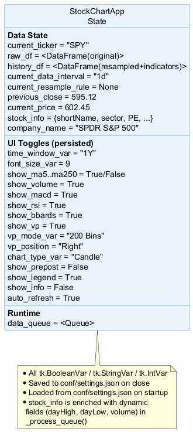

### 2.4 Caching & Persistence Strategy

#### File Layout

```
chart-app/
├── conf/
│   ├── settings.json        # UI state (toggles, font, window)
│   └── watchlist.csv         # Watchlist groups and tickers
└── csv/
    ├── SPY_1d_2026-02-12.csv       # OHLCV price cache
    ├── SPY_1m_2026-02-12.csv       # Intraday cache
    ├── SPY_1h_2026-02-12.csv       # Hourly cache
    ├── SPY_info.csv                # Metadata sidecar
    └── ...
```

#### Naming Conventions

| File Pattern                         | Contents                                    | Example                        |
| :----------------------------------- | :------------------------------------------ | :----------------------------- |
| `{ticker}_{interval}_{date}.csv`     | OHLCV time-series data                      | `SPY_1d_2026-02-12.csv`       |
| `{ticker}_info.csv`                  | Static metadata key-value pairs             | `SPY_info.csv`                 |
| `debug_{ticker}_{interval}_{date}.csv` | Debug output from `debug_price.py`          | `debug_ORCL_1h_2026-01-01.csv` |

#### TTL & Freshness Rules

| Artifact                          | TTL                          | Refresh Trigger                                              |
| :-------------------------------- | :--------------------------- | :----------------------------------------------------------- |
| OHLCV cache (`*_{interval}_*.csv`) | Until data is stale          | Incremental fetch if `last_date < today` or intraday         |
| Metadata sidecar (`*_info.csv`)    | 30 days                      | Full API re-fetch if >30 days or missing expected keys       |
| Settings (`settings.json`)         | Permanent                   | Overwritten on every app close                               |
| Watchlist (`watchlist.csv`)        | Permanent                   | Written on every CRUD operation                              |
| Old cache cleanup                  | Files older than 7 days      | Runs once at startup via `cleanup_old_cache()`               |

#### Metadata Validation Keys

The metadata loader (`load_ticker_metadata`) forces a refresh if any of these keys are missing:
`dividendRate`, `yield`, `fiftyTwoWeekLow`, `beta`, `previousClose`.

### 2.5 Rendering Pipeline

📄 [PlantUML Source](design-diagram/07-rendering-pipeline.puml)

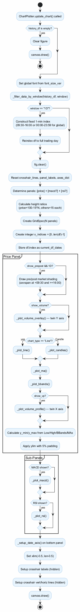

### 2.6 Interaction Flow — Window Change

📄 [PlantUML Source](design-diagram/08-window-change.puml)

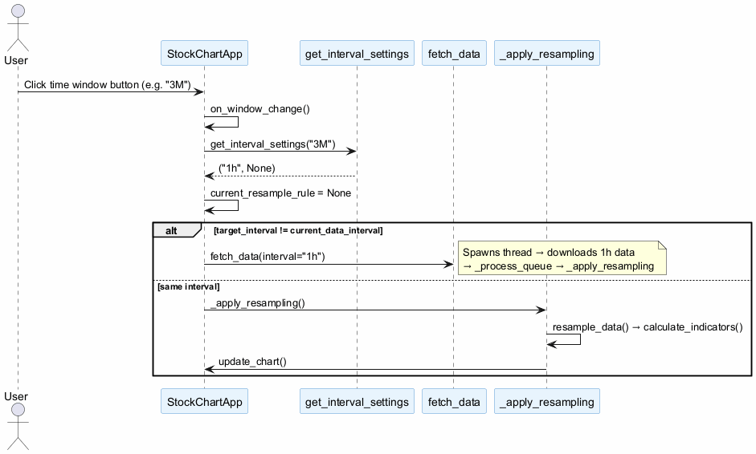

### 2.7 Interaction Flow — Resampling Pipeline

📄 [PlantUML Source](design-diagram/09-resampling-pipeline.puml)

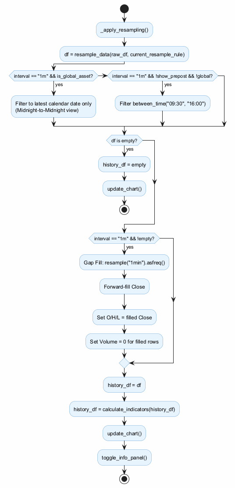

### 2.8 Interaction Flow — Crosshair

📄 [PlantUML Source](design-diagram/10-crosshair.puml)

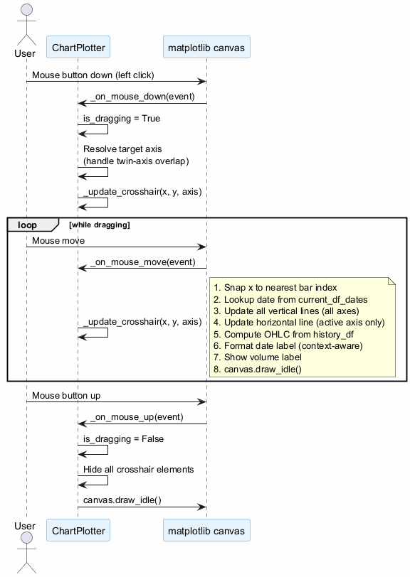

---

## 3. Data Model

### 3.1 Entity-Relationship Diagram

📄 [PlantUML Source](design-diagram/11-erd.puml)

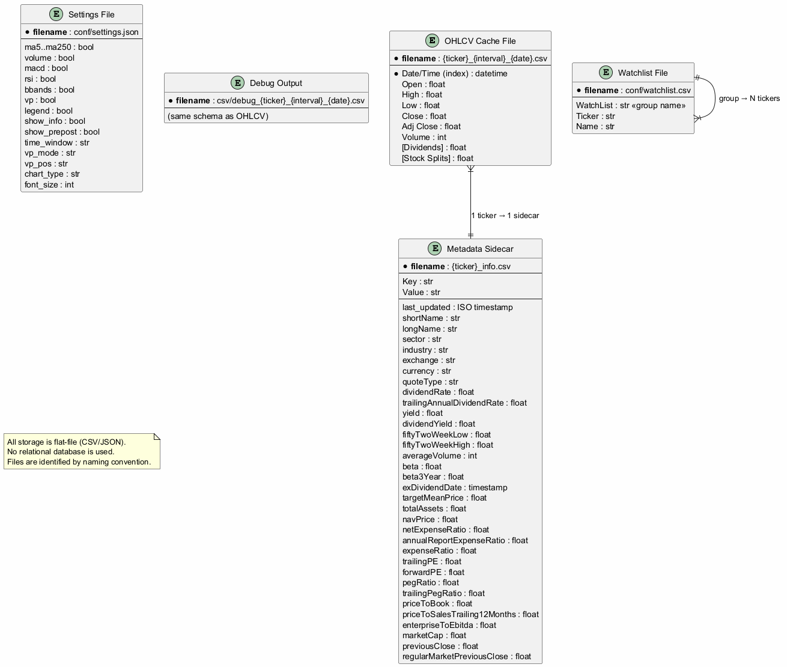

---

## 4. Cross-Cutting Concerns

### 4.1 Logging

| Module               | Logger Name  | Level   | Notes                                                  |
| :------------------- | :----------- | :------ | :----------------------------------------------------- |
| `app_stock_chart.py` | `__main__`   | INFO    | Configures root logger with `basicConfig()`            |
| `chart_drawing.py`   | module-level | INFO    | Uses `getLogger(__name__)`                             |
| `stock_util.py`      | module-level | INFO    | Also calls `basicConfig()` (redundant but harmless)    |
| `info_panel.py`      | module-level | INFO    | Uses `getLogger(__name__)`                             |
| `watchlist.py`       | module-level | INFO    | Uses `getLogger(__name__)`                             |

All modules use the standard `logging` library with format `%(asctime)s - %(levelname)s - %(message)s`. No log files are written; all output goes to `stderr`.

### 4.2 Error Handling

The application follows a **defensive fallback** strategy:

| Area                    | Strategy                                                                                       |
| :---------------------- | :--------------------------------------------------------------------------------------------- |
| Network failures        | `try/except` around all `yfinance` calls; returns empty `DataFrame` on failure                 |
| Corrupt cache           | `try/except` on `pd.read_csv()`; sets `df = None` to trigger full re-download                 |
| Missing metadata fields | Validation loop checks for expected keys; forces API refresh if any are missing                |
| Chart rendering         | Multiple `try/except` blocks; falls back to default axis limits `(0, 100)` on NaN/Inf         |
| Crosshair lookup        | Clips index to `[0, len-1]`; catches `KeyError` for OHLC row lookup                           |
| Settings I/O            | `try/except` on both `load_settings()` and `save_settings()`; uses defaults if file is missing |
| Thread errors           | Worker thread catches `Exception` and pushes `('error', str(e))` to queue                     |

### 4.3 DPI Awareness

```python
# app_stock_chart.py, lines 27-30
try:
    ctypes.windll.shcore.SetProcessDpiAwareness(1)
except Exception:
    pass
```

- Uses Windows `shcore.SetProcessDpiAwareness(1)` for **System DPI Aware** mode.
- Wrapped in `try/except` for cross-platform safety (no-op on non-Windows).
- The `font_size_var` (range 4–24) provides additional manual scaling for FHD vs 4K monitors.
- Font changes propagate to all widgets via `tkfont.nametofont("TkDefaultFont")` and `root.option_add()`.

### 4.4 Performance Considerations

| Concern                     | Mitigation                                                                                                    |
| :-------------------------- | :------------------------------------------------------------------------------------------------------------ |
| API rate limiting            | Incremental cache prevents full re-downloads; metadata cached for 30 days                                    |
| Large DataFrame rendering   | Integer-indexed plotting avoids `mdates` overhead; `draw_idle()` used for crosshair updates                  |
| Indicator computation       | Rolling/vectorized calculations avoid many Python-level loops; no timing threshold was reproduced in this documentation update           |
| Memory                      | Only one `raw_df` + one `history_df` in memory at a time per ticker; no historical multi-ticker storage      |
| Thread safety               | `queue.Queue` is the only shared mutable resource; all GUI mutations are main-thread only                    |
| Cache disk usage             | `cleanup_old_cache()` purges files > 7 days old at startup                                                   |
| Volume Profile rendering    | Row-by-row iteration (`df.iterrows()`) for VP distribution; potential bottleneck for large datasets          |
| Startup time                | Local settings, watchlist and cache can be reused; network fetching runs in the background, with no reproduced startup-time benchmark            |

---

## Window-to-Interval Mapping

Reference table for `get_interval_settings()`:

| Time Window | `target_interval` | `resample_rule` | Effective Bar Size | Notes                          |
| :---------- | :----------------- | :-------------- | :----------------- | :----------------------------- |
| `20Y`       | `1d`               | `MS`            | Monthly            | Month Start bucketing          |
| `10Y`       | `1d`               | `MS`            | Monthly            | Month Start bucketing          |
| `5Y`        | `1d`               | `W-MON`         | Weekly             | Week starting Monday           |
| `3Y`        | `1d`               | `3D`            | 3 Trading Days     | Custom integer-day resampling  |
| `2Y`        | `1d`               | `2D`            | 2 Trading Days     | Custom integer-day resampling  |
| `1Y`        | `1d`               | `None`          | Daily              | No resampling                  |
| `YTD`       | `1h` or `1d`       | `None`          | Hourly or Daily    | ≤90 days → 1h; >90 days → 1d  |
| `6M`        | `1d`               | `None`          | Daily              | No resampling                  |
| `3M`        | `1h`               | `None`          | Hourly             | No resampling                  |
| `1M`        | `1h`               | `None`          | Hourly             | No resampling                  |
| `1WK`       | `5m`               | `10min`         | 10 Minutes         | 5m fetched, resampled to 10m  |
| `1D`        | `1m`               | `None`          | 1 Minute           | No resampling                  |

---

## Moving Average Color Map

| MA Period | Color   | `tk.BooleanVar`   | Default |
| :-------- | :------ | :---------------- | :------ |
| MA 5      | Cyan    | `show_ma5`        | True    |
| MA 20     | Green   | `show_ma20`       | True    |
| MA 50     | Orange  | `show_ma50`       | True    |
| MA 60     | Blue    | `show_ma60`       | False   |
| MA 100    | Purple  | `show_ma100`      | True    |
| MA 120    | Magenta | `show_ma120`      | False   |
| MA 200    | Red     | `show_ma200`      | True    |
| MA 250    | Brown   | `show_ma250`      | True    |

---

## 5. Browser Modernization Reference Design

### 5.1. Scope and reading guide

This reference design describes the NiceGUI/Plotly application implemented and inspected in the separate `gui-stock-chart` modernization workspace. Its `app/` and `tests/` paths are source-snapshot references, not files available in this public checkout. The public [README](readme.md) and [Algorithm Deep-Dive](chart-app/algorithm.md) continue to describe the published desktop application.

**Publication boundary:** `chart-app/app_stock_chart.py` still defines `StockChartApp` and imports `ChartPlotter`. The browser snapshot instead defines `StockChartSession`, `PlotlyChartBuilder` and `ChartInteractions`. Updating these documents does not synchronize the application source or replace the desktop dependency manifest.

In the modernization snapshot, the active entry point is app_stock_chart.py (`gui-stock-chart/app/app_stock_chart.py`), which imports `PlotlyChartBuilder` and `ChartInteractions`. The older `chart_drawing.py` is a retained Matplotlib implementation and is not imported by this entry point. The desktop ancestry explains the product requirements; it is not the execution architecture described below.

**Evidence conventions:** “implemented” refers to inspected source; “verified” refers to the checks listed in section 5.12. Dependency requirements are distinct from locally observed versions. Browser rendering avoids the native Tk/X11 drawing path, but identical appearance on every operating system and display has not been established by testing.

### 5.2. Purpose and end-to-end behavior

The app supports personal exploration of stocks, ETFs, and supported global-asset symbols: choose a ticker and horizon, inspect price and technical indicators, compare historical windows at a consistent bar scale, and organize watchlists. It displays market data and derived indicators; no order-execution integration is implemented in the inspected application.

The user workflow connects a ticker selection to cached data, analysis, and a synchronized chart.

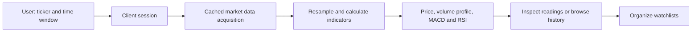

#### Entry points

| Entry | Trigger | Work and result | Source |
| --- | --- | --- | --- |
| Browser page `/` | Open the app | Construct a `StockChartSession`, toolbar, info card, Plotly widget and interaction component; schedule the initial fetch | index_page / build_ui (`gui-stock-chart/app/app_stock_chart.py:611`) |
| Ticker submission | Go, Enter or watchlist selection | Normalize the submitted symbol and schedule a guarded background fetch | trigger_fetch (`gui-stock-chart/app/app_stock_chart.py:396`) |
| Horizon selection | One of 12 time buttons | Reuse raw data when the interval permits, otherwise fetch the required interval | on_window_change (`gui-stock-chart/app/app_stock_chart.py:382`) |
| Automatic refresh | 60-second timer | Refresh only an enabled, idle, latest `1D` viewport | _auto_refresh_tick (`gui-stock-chart/app/app_stock_chart.py:555`) |
| Browser interactions | Pointer, drag, horizontal wheel, Shift+wheel | Inspect a shared bar or move a bounded, fixed-width viewport | interaction component (`gui-stock-chart/app/chart_interactions.js`) |
| Diagnostics CLI | `python app/debug_price.py TICKER INTERVAL START_DATE` | Fetch raw data, report gaps/statistics and save a diagnostic CSV | debug_price.main (`gui-stock-chart/app/debug_price.py:71`) |

### 5.3. C4 architecture

#### C1 — System context

The application serves a user through a browser and obtains external market data through `yfinance`.

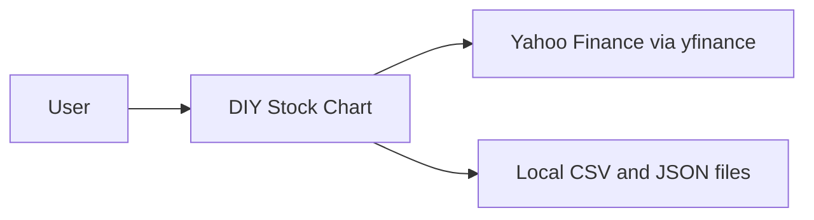

#### C2 — Runtime containers and stores

The browser and Python server are separate runtime environments. The worker pool belongs to the Python process; it is not a separately deployed service.

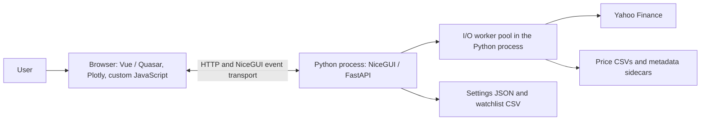

Python can run on native Windows or Linux/WSL while the browser renders on the host. The launcher specifies port `8080`, `reload=False`, and `show=True`. It does not explicitly set a bind host. Public hosting, TLS, authentication, reverse proxies, and per-user storage are not configured by this application. Launcher (`gui-stock-chart/app/app_stock_chart.py:617`)

#### C3 — Components and responsibilities

The controller coordinates services; the browser component owns pointer-frequency work.

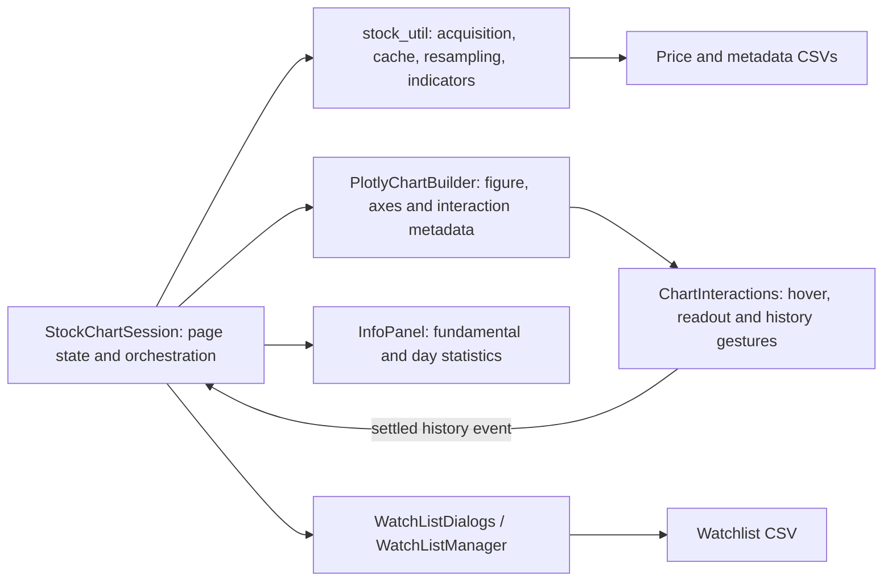

### 5.4. Technology and runtime configuration

| Layer | Manifest requirement | Observed local version / role |
| --- | --- | --- |
| Python | No explicit Python version declaration in the app manifest | 3.14.7 in the verification environment |
| NiceGUI | `>=2.11.0` | 4.0.0; page lifecycle, event transport, dialogs, worker dispatch and fullscreen control |
| Plotly | `>=5.20.0` | 7.1.0; financial traces, subplot axes and browser rendering |
| pandas / NumPy | `>=2.1.0` / `>=1.26.0` | 3.0.5 / 2.5.3; tabular processing and profile calculations |
| yfinance | `>=0.2.40` | 1.7.0; external OHLCV and metadata access |
| FinTA / pytz | `>=1.3` / `>=2024.1` | 1.3 / 2026.6; indicators and Eastern time conversion |
| Browser JavaScript | No JavaScript build step | NiceGUI custom component; Node.js is needed only for helper tests |
| Persistence | Filesystem | CSV and JSON, with no application-authored SQL found in the inspected modules |
| AI / CUDA | No inference or CUDA integration found in the active imports | AI assisted development; it does not participate in chart calculations at runtime |

The manifest contains lower bounds, not a dependency lockfile. The observed versions are a tested snapshot, not a guarantee that every allowed dependency combination has been tested. requirements.txt (`gui-stock-chart/app/requirements.txt`)

### 5.5. Flow inventory and source-to-flow ledger

The following ledger anchors the branches and arrows in the detailed diagrams.

| Flow | Trigger / predicate | Calls, state changes and result | Source |
| --- | --- | --- | --- |
| F0 — acquisition | Submitted ticker; initial one-shot timer; fetch needed after a horizon change | Capture ticker, window and request ID; dispatch `run.io_bound`; accept only the current request; resample, compute and redraw | controller (`gui-stock-chart/app/app_stock_chart.py:396`), cache service (`gui-stock-chart/app/stock_util.py:136`) |
| F1 — horizon | Target interval differs, raw data is empty, or a request is loading | Reset to latest and fetch; otherwise resample existing raw data | on_window_change (`gui-stock-chart/app/app_stock_chart.py:382`) |
| F2 — inspection | Pointer is inside a configured pane | Convert axis coordinates, select nearest bar, update crosshairs and readout locally | locateHover (`gui-stock-chart/app/chart_interactions.js:93`), buildReading (`gui-stock-chart/app/chart_interactions.js:131`) |
| F3 — navigation | Drag or horizontal / Shift+wheel gesture | Clamp fixed-span range, update all panes locally, emit a settled start/context, validate and rebuild | browser navigation (`gui-stock-chart/app/chart_interactions.js:285`), on_history_change (`gui-stock-chart/app/app_stock_chart.py:535`) |
| F4 — display controls | Chart toggle, theme/font change, Show Info, or fullscreen click | Persist supported preferences and redraw or show the card; fullscreen remains browser state | build_ui / handlers (`gui-stock-chart/app/app_stock_chart.py:177`) |
| F5 — refresh | `auto_refresh`, ticker present, `1D`, idle and `view_start is None` | Call the shared fetch path with `silent=True` | _auto_refresh_tick (`gui-stock-chart/app/app_stock_chart.py:555`) |
| F6 — watchlists | Star, add-dialog Save or management action | Update ordered groups/tickers, save CSV, refresh menu/star; ticker-name lookup uses a worker | watchlist module (`gui-stock-chart/app/watchlist.py`) |
| F7 — diagnostic CLI | Three positional arguments | Direct provider fetch, console analysis and `debug_*.csv` write | main (`gui-stock-chart/app/debug_price.py:71`) |

#### F0 — Shared acquisition and rendering

The request ID protects presentation state from an older response. It does not cancel an in-flight worker or prevent that worker from touching the shared cache. A newer request owns its own loading state; an older completion cannot clear it. fetch_data (`gui-stock-chart/app/app_stock_chart.py:408`)

**Activity diagram for acquisition:** Submit, fetch, reject stale responses, and render only an accepted result.

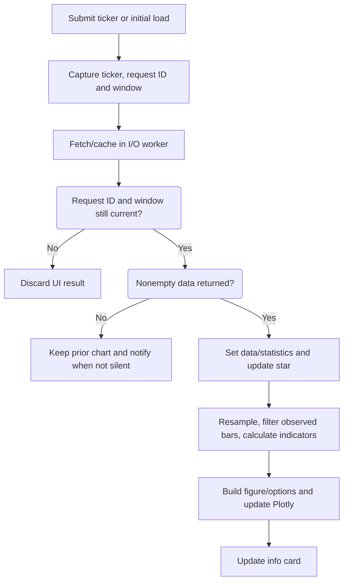

**Sequence diagram for acquisition:** The controller awaits the worker, then applies the matching result on its event loop.

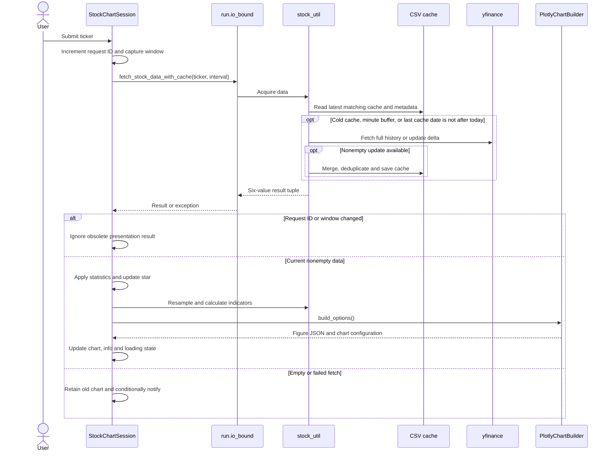

The chart builder makes a separate display copy for session minute grids. Indicators are computed before display-only gap filling, so invented flat candles do not enter SMA/MACD/RSI calculations. Historical MA warmup remains available outside the visible range. Resampling handler (`gui-stock-chart/app/app_stock_chart.py:504`), intraday grid (`gui-stock-chart/app/chart_plotly.py:59`)

#### F1 — Horizon change

**Activity diagram for horizon selection:** The selected provider interval decides whether a worker is needed.

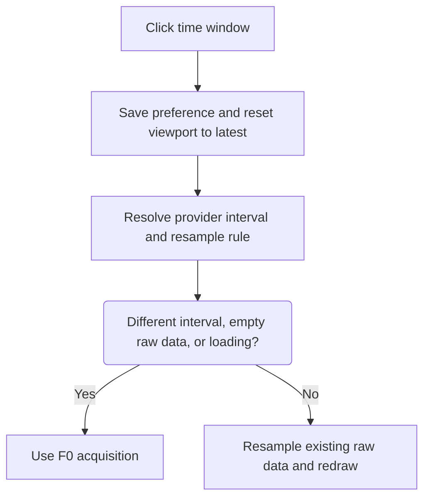

**Sequence diagram for horizon selection:** Reuse and fetch paths both end in the same analysis/rendering pipeline.

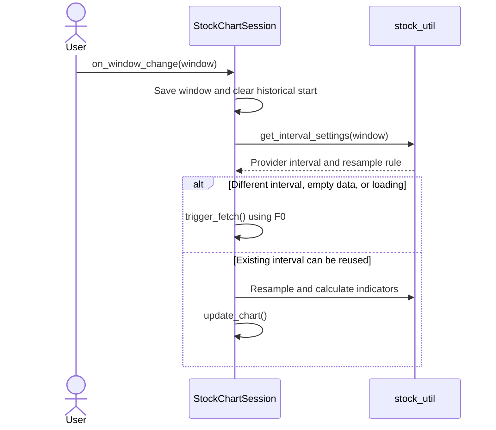

#### F2 — Pointer inspection

**Activity diagram for inspection:** Only the hovered pane receives horizontal and axis readings; the vertical crosshair spans all enabled panes.

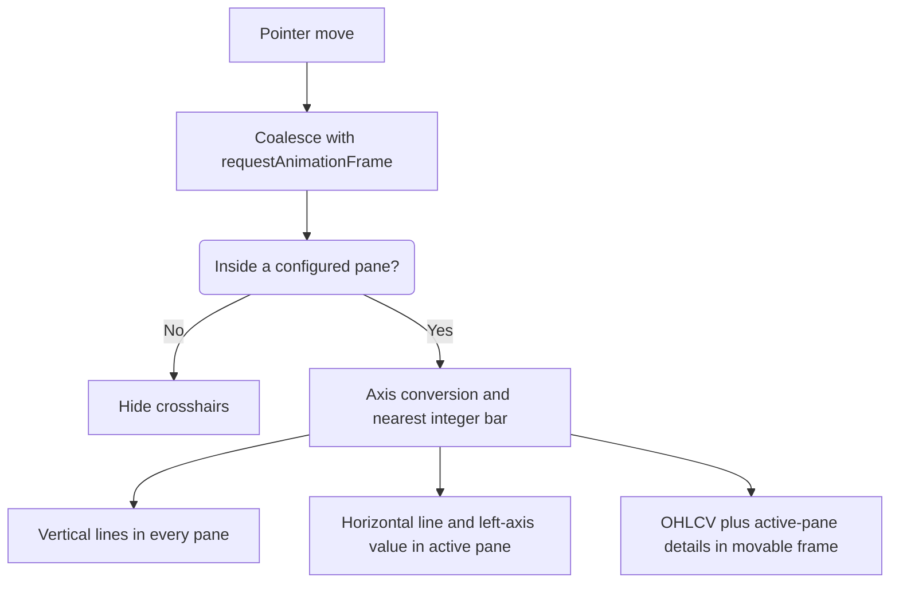

**Sequence diagram for inspection:** No backend request is required for each pointer position.

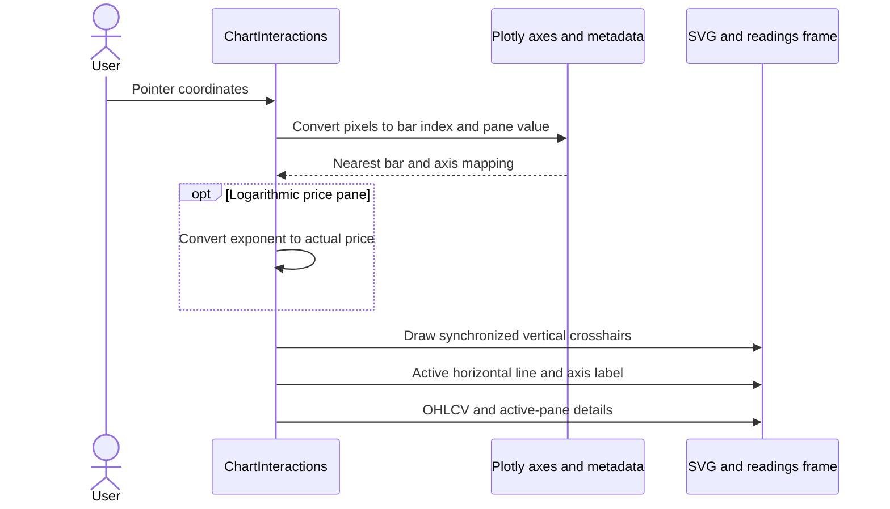

OHLC remains visible when hovering MACD or RSI. MA readings appear in the price pane, MACD/signal/histogram details in MACD, and the RSI reading in RSI. The RSI axis label follows pointer height, not the bar's RSI value. Missing values display a dash. The frame can be dragged, collapsed, or moved with arrow keys; its position is clamped to the workspace. These are browser-component states, not saved preferences.

#### F3 — Fixed-width history navigation

Let `N` be the full displayed-history length and `S` the latest selected window's bar count. A settled starting bar `i` satisfies `0 <= i <= N-S`; the X range is `[i-0.5, i+S-0.5]`. Dragging can use fractional coordinates for smooth movement; the committed start is rounded to a bar. This preserves bar spacing, not an exact calendar duration for every older window. A five-year selection is a reference span of weekly bars. historyRange / visibleRanges (`gui-stock-chart/app/chart_interactions.js:16`)

**Activity diagram for navigation:** Gestures update the chart locally before Python commits the settled viewport.

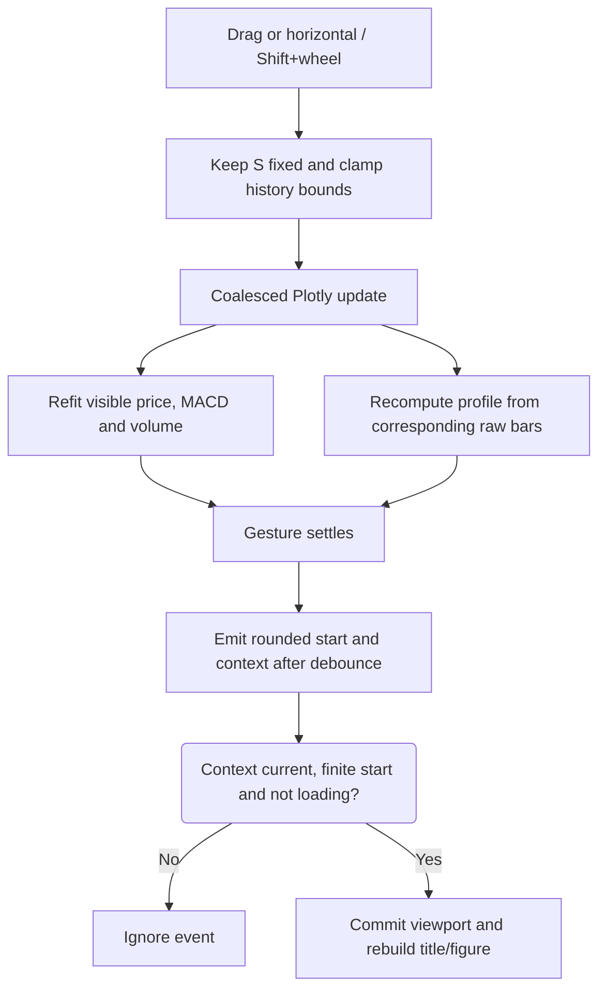

**Sequence diagram for navigation:** Hover stays local, while navigation sends a debounced event after dragging or wheel activity settles.

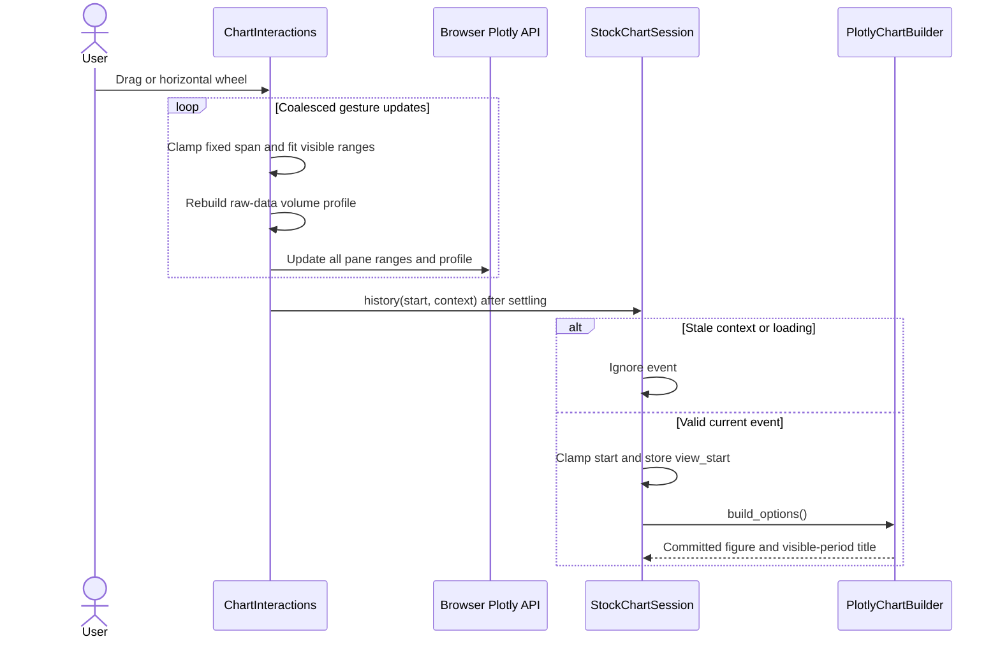

Moving right while dragging reveals older data; moving left returns toward latest. Horizontal trackpad deltas and Shift+vertical wheel use the same clamped range calculation. Ordinary vertical page scrolling is left to the browser. Movement stops at both loaded-history edges. Panning does not request an older provider dataset when the earliest loaded bar is reached.

The context includes ticker, window, interval, Pre/Post, price scale, first date, total count and span. It rejects outdated viewport events after a context change. `None` means follow latest; an integer means browse history. Selecting a time button again returns to latest. Metadata contract (`gui-stock-chart/app/chart_plotly.py:708`), controller validation (`gui-stock-chart/app/app_stock_chart.py:535`)

#### F4 — Display controls and fullscreen

**Activity diagram for display controls:** Saved chart settings, the info card, and browser fullscreen have different lifetimes.

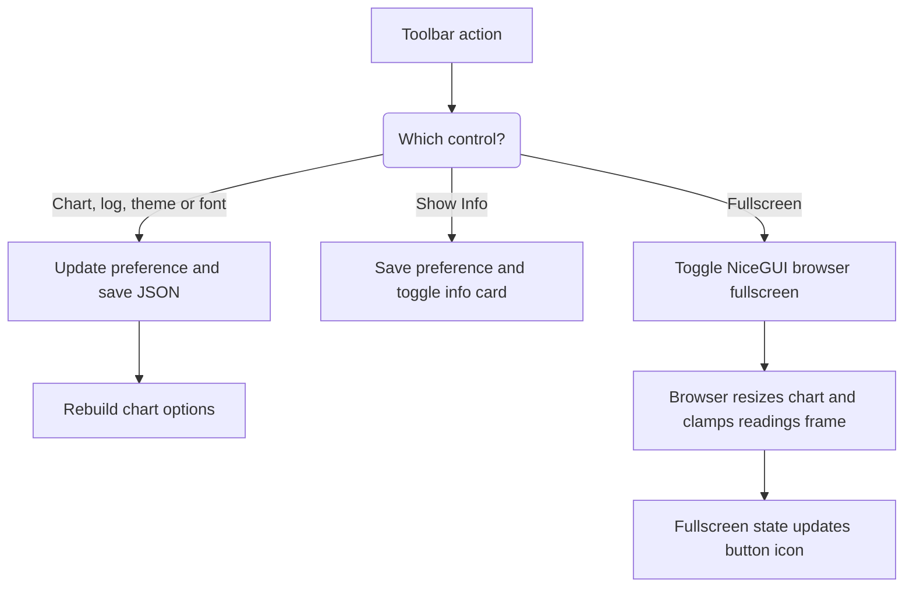

**Sequence diagram for display controls:** Log changes display geometry; fullscreen uses the framework's browser control.

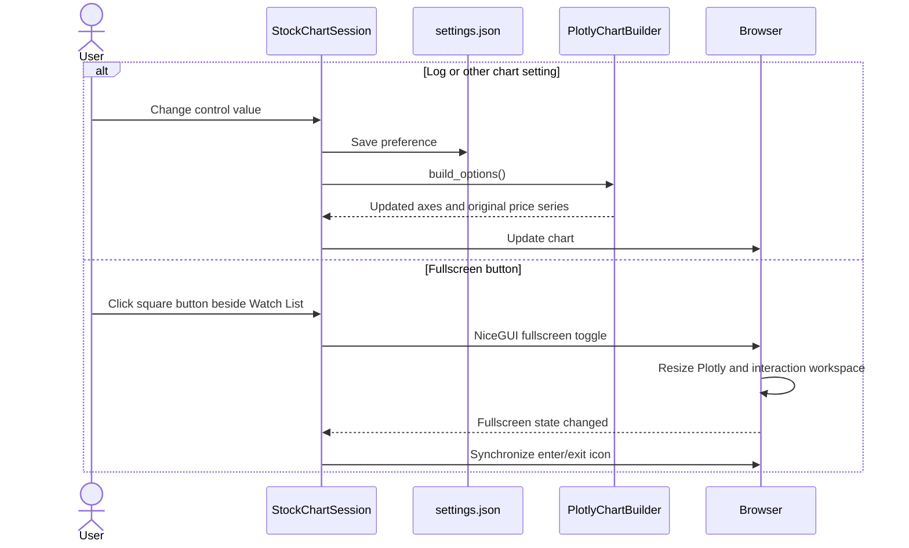

The **Log** checkbox follows **Show Info**, defaults to unchecked, and is persisted. Only the price Y-axis becomes logarithmic. Positive finite prices are transformed to log10 for range fitting, padded in exponent space, and passed to Plotly as a log-axis range. Traces, OHLC readouts, SMAs and profile price coordinates remain in original units. MACD, RSI and volume stay on their normal scales. Switching display scale does not convert an SMA into an EMA. Range fitting (`gui-stock-chart/app/chart_plotly.py:45`), live fitting (`gui-stock-chart/app/chart_interactions.js:44`)

Fullscreen is entered by a user click and is not a saved setting. Clicking again or using the browser's Escape exit returns to the normal viewport. `ui.fullscreen()` supplies state tracking and the button binds its icon to that state. Plotly's responsive configuration and the component's `ResizeObserver` handle geometry changes. Fullscreen button (`gui-stock-chart/app/app_stock_chart.py:209`)

#### F5 — Automatic 1D refresh

**Activity diagram for refresh:** The timer uses all five guards before entering the shared fetch flow.

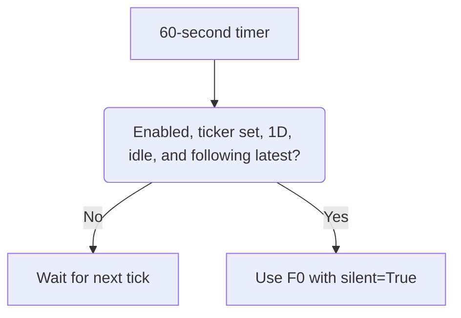

**Sequence diagram for refresh:** Toggling Auto 1D changes a preference; fetching occurs on an eligible timer tick.

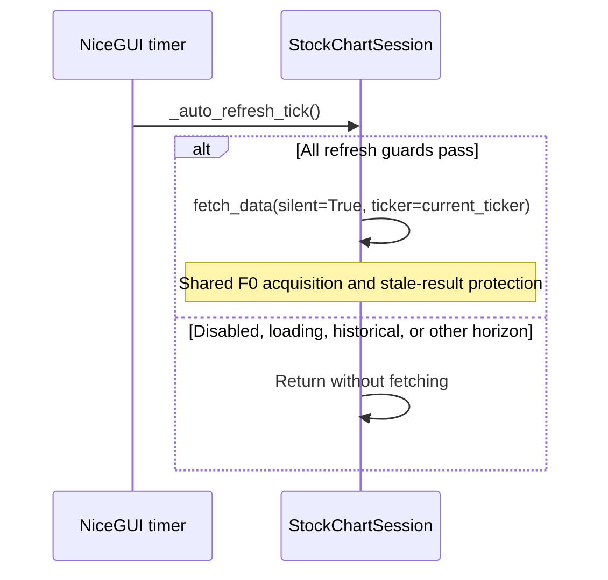

#### F6 — Watchlist management

**Activity diagram for watchlists:** Ordered file-backed operations refresh both the menu and management view.

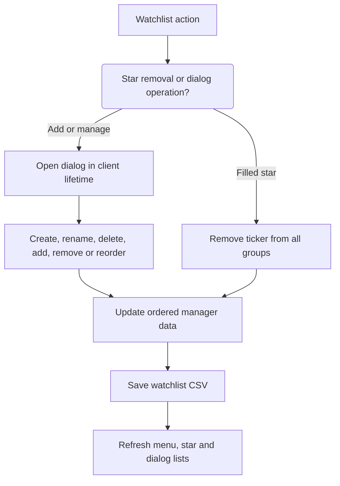

**Sequence diagram for watchlists:** A ticker-name lookup is optional; CSV persistence follows the selected mutation.

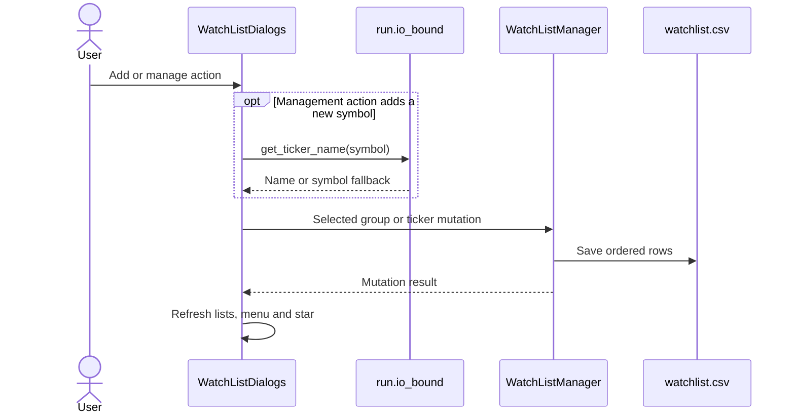

An empty group is serialized as a row with a blank ticker/name, so deleting its final ticker does not delete the group. The management dialog is attached to the client rather than a rebuildable menu subtree. File errors are logged; manager methods do not implement transactional rollback. CSV representation (`gui-stock-chart/app/watchlist.py:24`), dialog lifetime (`gui-stock-chart/app/watchlist.py:247`)

#### F7 — Data diagnostics

**Activity diagram for diagnostics:** This separate CLI writes a CSV and reports heuristic gaps without changing GUI state.

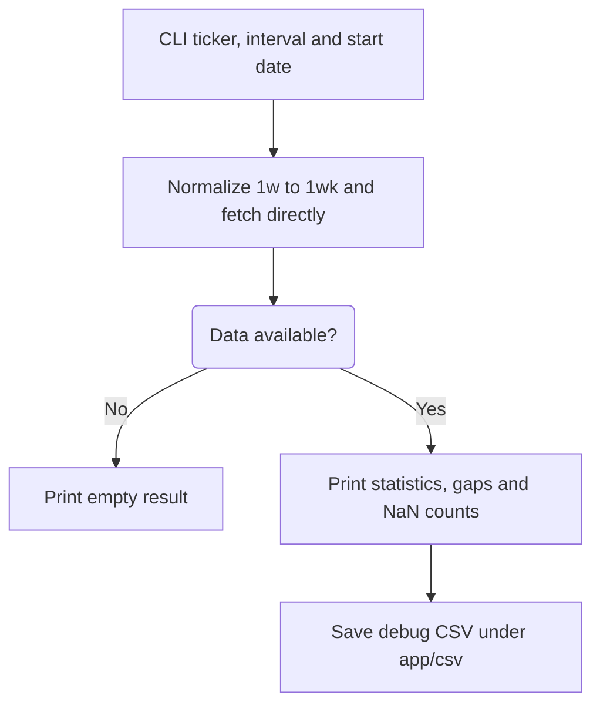

**Sequence diagram for diagnostics:** The CLI bypasses the GUI cache orchestration.

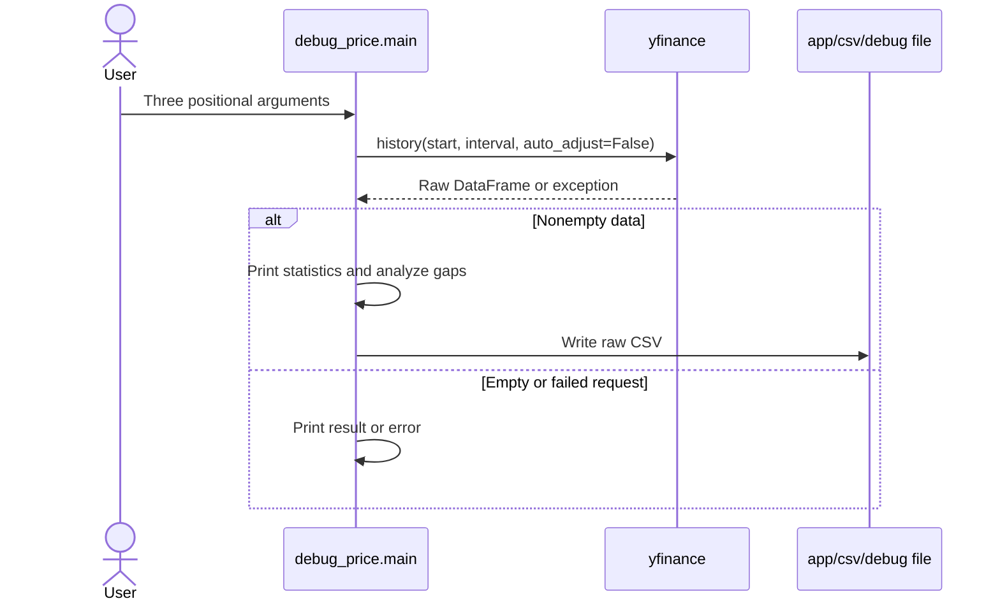

The debugger's market-gap rules are heuristics, not an exchange-calendar validator. Provider failures are printed rather than translated into an application error-code catalog. Diagnostics (`gui-stock-chart/app/debug_price.py`)

### 5.6. Low-level component contracts

| Component / method | Input and output | Responsibility and invariant |
| --- | --- | --- |
| `StockChartSession.__init__`, `build_ui` | One page's controls and state | Construct services, load preferences, wire events/timers; no global chart session |
| `trigger_fetch` | Optional interval; submitted ticker captured at invocation | Reset to latest, increment request ID, create background task |
| `fetch_data` | Interval, silent flag, captured ticker/request ID | Await six-value result, reject obsolete responses, apply data and loading state |
| `_apply_resampling` | `raw_df`, interval/rule, asset type | Filter observed bars and compute full-history indicators before chart grid expansion |
| `update_chart` | Session state | Call `build_options()` and `plotly_widget.update_figure()` |
| `on_history_change` | Event `{start, context}` | Reject invalid/stale events, clamp start and store latest sentinel or index |
| `load_settings`, `save_settings` | JSON preferences | Resolve relative to module directory; log I/O failures |
| `PlotlyChartBuilder.build_figure` | Session data and display settings | Return `go.Figure` with explicit ranges, panel mapping and interaction metadata |
| `build_options` | Figure | Add image-export-only configuration and disable native zoom/selection |
| `_filter_data_by_window`, `_intraday_grid` | Dated history and selected horizon | Determine reference span; retain prior session grids for navigation |
| `_raw_view_bounds` | Aggregated start/stop | Map a visible candle window to the contributing raw-data interval |
| `_compute_volume_profile` | Raw visible OHLCV | Return centers, allocated volumes and bin height |
| `_fit_range`, `_compute_date_ticks`, `_format_hover_dates` | Visible values or dated history | Fit finite ranges, resolve tick collisions and label represented periods |
| `ChartInteractions` Python adapter | Dark preference and history callback | Register the custom component, CSS and history event |
| `locateHover`, `buildReading`, `clampPanel` | Axes, metadata, pointer/frame geometry | Consistent bar lookup, pane-specific details and workspace bounds |
| `historyRange`, `historyWheelPixels`, `visibleRanges` | Navigation metadata and gesture/viewport | Fixed span, input direction and live fitting/profile computation |
| `InfoPanel.build`, `toggle`, `update_content` | Session information | Collapsible card with stock/ETF field formatting; separate from floating OHLC frame |
| `WatchListManager` | Ordered groups and ticker records | Create, rename, delete, reorder, save and load |
| `WatchListDialogs` | Session and manager | Add and manage UI; keep the dialog alive through menu refreshes |

Implementation sources: controller (`gui-stock-chart/app/app_stock_chart.py`), builder (`gui-stock-chart/app/chart_plotly.py`), browser component (`gui-stock-chart/app/chart_interactions.js`), info card (`gui-stock-chart/app/info_panel.py`), watchlists (`gui-stock-chart/app/watchlist.py`).

#### Browser metadata contract

`layout.meta.stock_chart` is the shared rendering contract. It contains plain JSON arrays with nonfinite values serialized as `null`, avoiding a dependency on Plotly's typed-array encoding for readout lookup.

| Field | Contents / use |
| --- | --- |
| `dates` | One represented-date label per global integer bar |
| `series` | OHLCV, enabled MAs and indicator/band values used by inspection and fitting |
| `moving_averages` | Enabled MA keys, labels and colors |
| `panels` | Price/MACD/RSI keys and their current X/Y axis IDs |
| `price_scale`, `dark`, `font_size` | Display settings required by the component |
| `navigation` | Range, fixed span, total length, latest flag, visible dates and dataset context |
| `profile` | Raw low/high/volume arrays, raw-start offsets for displayed bars, bin count and side |

Every plotted history trace uses the same full-history integer coordinates. Indicator panel changes alter axis IDs; `uirevision` includes the panel combination and price scale to avoid reusing incompatible saved axis state. Figure construction (`gui-stock-chart/app/chart_plotly.py:338`)

#### Axis ownership

| Axis | Data / range | Interaction behavior |
| --- | --- | --- |
| Primary `x`, `y` | Price candles/line, MAs and bands | `x` uses the fixed bar viewport; `y` fits visible price-related values in linear or log coordinates |
| `y9` overlay | Volume on primary X | Always linear; range `[0, 4 * visible_max_volume]` reserves roughly the lower quarter |
| `x9` overlay | Horizontal volume profile on primary Y | `[4 * max_profile_volume, 0]` on the right, or `[0, 4 * max_profile_volume]` on the left |
| Indicator rows | Shared bar coordinates, separate Y axes | MACD fits visible MACD/signal/histogram including zero; RSI retains `[0, 100]` |

The profile shares the actual price Y-axis, so its bins stay aligned in log mode. Volume's independent Y-axis does not inherit the log type. Native hover boxes, selection, double-click autoscale, wheel zoom and axis editing are disabled; the custom component owns history gestures, with image export retained.

### 5.7. Data acquisition and numerical algorithms

#### Cache behavior

| Case | Implemented policy |
| --- | --- |
| Cache discovery | Select the most recently modified `{ticker}_{interval}_*.csv`; normalize columns and index to Eastern time |
| `1m` | Request a fresh five-day buffer with Pre/Post, merge with cached minutes, deduplicate timestamps keeping the new row, and sort |
| Cold `1d` | Request from `2000-01-01`; the provider and symbol determine actual availability |
| Cold `1h` | Request approximately 700 days |
| Other configured short intraday intervals | Request approximately 55 days |
| Existing daily/hourly/intraday cache | Request from its final date, including a same-day update, then replace duplicate timestamps |
| Split in returned delta | Attempt a full refresh; this is a detected-delta repair path, not a comprehensive corporate-action engine |
| Metadata sidecar | Reuse when within 30 days and required keys are present; otherwise request metadata |
| Startup cleanup | Remove price CSVs older than seven days by modification time; preserve metadata sidecars |

These are app request policies, not promises about Yahoo Finance retention or availability. Refresh fallback can display older cached data; the app does not guarantee real-time prices. `auto_adjust=False` is used, so the chart is not a dividend-reinvestment or total-return calculation. stock_util.py (`gui-stock-chart/app/stock_util.py`)

#### Horizon-to-interval mapping

| Horizon | Provider interval | Display aggregation |
| --- | --- | --- |
| `20Y`, `10Y` | `1d` | Month-start `MS` |
| `5Y` | `1d` | Weekly `W-MON`, explicitly left-labeled/closed |
| `3Y` | `1d` | Consecutive groups of three trading rows |
| `2Y` | `1d` | Consecutive groups of two trading rows |
| `1Y`, `6M` | `1d` | None |
| `YTD` | `1h` for the first 90 elapsed days, otherwise `1d` | None |
| `3M`, `1M` | `1h` | None |
| `1WK` | `5m` | Left-labeled/closed `10min` |
| `1D` | `1m` | One-minute session grid in the display copy |

OHLCV aggregation uses first open, maximum high, minimum low, last close, and summed volume. Two/three-day grouping records `period_start` so readouts and profiles can refer to the complete contributing period. The code treats `CRYPTOCURRENCY`, `CURRENCY` and `FUTURE` as a global-asset group for display filtering. That is an app classification, not proof that every such instrument trades continuously. Interval mapping and resampling (`gui-stock-chart/app/stock_util.py:336`)

Equity regular hours use 09:30–16:00 Eastern. The optional 1D extended grid spans 04:00–20:00; the global-asset grid spans 00:00–23:59. Flat display-only candles fill missing minutes between that session's first and last observed closes with zero volume. Future/unobserved edge minutes stay empty.

#### Indicators and volume profile

SMAs are rolling means of closing prices for 5, 20, 50, 60, 100, 120, 200 and 250 **bars after resampling**. A 250-bar SMA on the weekly chart is not a 250-day SMA. The defaults enable all except MA60 and MA120. Log display changes geometry without recomputing these averages. calculate_indicators (`gui-stock-chart/app/stock_util.py:410`)

FinTA supplies MACD, RSI and Bollinger Bands when available. A pandas fallback computes EMA12–EMA26, an EMA9 signal, Wilder-style RSI smoothing and 20-bar bands at two standard deviations. Initialization conventions can differ between libraries; this document does not claim exact FinTA/fallback numerical parity.

For `N` profile bins, `height = (max_high - min_low) / N`. Each positive-volume bar distributes its volume equally across the bins intersecting its low–high range. The profile uses contributing **raw bars**, even when candles are aggregated. It is an OHLCV-based approximation; it does not reconstruct actual trade-by-trade volume at each price. Browser raw-start offsets ensure the live and committed profile use the same represented slice. Empty/flat ranges yield an empty profile rather than division by zero. Profile algorithm (`gui-stock-chart/app/chart_plotly.py:299`)

Date tick placement prioritizes important period starts and removes less important nearby labels when they collide. The integer axis removes empty nontrading gaps; represented-date labels retain the real date or period information. Date ticks (`gui-stock-chart/app/chart_plotly.py:126`)

### 5.8. Interfaces

#### HTTP and event surface

The application defines a NiceGUI page at `/`. UI updates, component resources and event transport are framework-managed. No application-authored REST CRUD endpoints, authentication layer, order API or stable public HTTP error-code contract were found in the inspected modules.

The custom browser-to-Python event is `history` with `{start, context}`. `start` is a finite bar position that the controller clamps; `context` must match current metadata. Normal hover events do not cross this boundary. Adapter (`gui-stock-chart/app/chart_interactions.py`), event validation (`gui-stock-chart/app/app_stock_chart.py:535`)

#### Function and CLI contracts

| Interface | Return / output | Side effects |
| --- | --- | --- |
| `fetch_stock_data_with_cache(ticker, interval)` | `(df, company_name, interval, previous_close, current_price, info_dict)` | Provider access and CSV read/write |
| `get_interval_settings(window)` | `(target_interval, resample_rule)` | None |
| `resample_data(df, rule)` | Aggregated DataFrame | No file writes |
| `calculate_indicators(df)` | Copy with indicator columns | No file writes |
| `build_options()` | Figure JSON plus Plotly config | No provider access |
| `get_ticker_name(ticker)` | Cached/provider name or ticker fallback | May refresh metadata sidecar |
| `debug_price.py TICKER INTERVAL START_DATE` | Console report and diagnostic CSV | Direct provider request and file write |

### 5.9. Persistence, data model and configuration

Paths are anchored to each module's directory, so launching from the project root or `app/` does not change the storage location.

| Store | Schema / contents | Lifetime and ownership |
| --- | --- | --- |
| `app/csv/{ticker}_{interval}_{date}.csv` | Date index, OHLCV and optional provider columns | Shared local price cache |
| `app/csv/{ticker}_info.csv` | Key/value metadata, including quote type and descriptive/statistical fields | Shared local metadata cache |
| `app/conf/watchlist.csv` | `WatchList,Ticker,Name`; blank ticker/name represents an empty group | Shared ordered watchlist file |
| `app/conf/settings.json` | Chart toggles, selected window/type, theme, font, profile options and log preference | Shared persisted defaults for newly constructed sessions |
| `app/csv/debug_*.csv` | Raw diagnostic download | CLI artifact, not a GUI input contract |

These are file schemas, not relational tables; no foreign-key enforcement, transactions, migrations or SQL queries are implemented here.

The data ownership view separates shared files from per-page state.

```mermaid
flowchart LR
    P["Page session"] --> R["raw_df and history_df"]
    P --> V["view_start and current ticker/window"]
    P --> F["Shared settings and watchlist files"]
    R --> C["Shared cache and metadata files"]
    B["Browser component"] --> G["Pointer, readout position and collapsed state"]
    B --> X["Transient fullscreen state"]
```

#### Saved settings and defaults

| Group | Keys / defaults |
| --- | --- |
| SMA visibility | `ma5`, `ma20`, `ma50`, `ma100`, `ma200`, `ma250`: true; `ma60`, `ma120`: false |
| Chart overlays | `volume`, `macd`, `rsi`, `bbands`, `vp`, `legend`: true |
| Main display | `time_window=1Y`, `chart_type=Candle`, `log_scale=false`, `show_prepost=false`, `show_info=false` |
| Profile | `vp_mode=200 Bins`, `vp_pos=Right`; controls offer 100/200/400 bins |
| Appearance / refresh | `dark_mode=true`, `font_size=12`, `auto_refresh=true` |

Settings save on control changes. A saved value overrides its default. Fullscreen, hover/readout state and `view_start` are not persisted. Each page owns its chart state, but the files are shared across pages and sessions: there is no user identity or file locking, so this is not isolated multi-user persistence. Settings (`gui-stock-chart/app/app_stock_chart.py:107`), watchlist persistence (`gui-stock-chart/app/watchlist.py:52`)

### 5.10. Exceptions and error behavior

| Boundary | Condition | Implemented behavior |
| --- | --- | --- |
| Cache loading | Missing or unreadable price CSV | Attempt a fresh provider request |
| Incremental / minute update | Provider raises and a cache exists | Log warning and retain cached bars |
| Cold provider fetch | Failure or empty data | Return an empty/absent dataset; controller keeps the prior chart and conditionally notifies |
| Metadata | Expired, missing keys, or fetch failure | Attempt refresh; missing fields can remain unavailable and formatting supplies placeholders |
| Concurrent requests | Request ID/window no longer current | Ignore obsolete UI result; only the current request may clear loading state |
| History event | Stale context, nonfinite/bad start, loading | Ignore event; valid starts are clamped |
| Settings / watchlist I/O | Parse or write exception | Log error; no transaction/rollback layer |
| Indicator dependency | FinTA import or calculation fails | Use pandas fallback |
| Log fitting | Nonpositive or nonfinite price levels | Exclude from log fitting; fallback exponent range if no usable values |
| CLI fetch | Provider exception | Print a diagnostic error; no custom exit-code catalog |

Framework transport recovery, browser fullscreen denial and provider retry internals are dependency behavior, not guarantees supplied by these handlers. Controller (`gui-stock-chart/app/app_stock_chart.py`), utilities (`gui-stock-chart/app/stock_util.py`), watchlists (`gui-stock-chart/app/watchlist.py`)

### 5.11. Engineering decisions and limits

| Decision | Benefit | Cost or boundary |
| --- | --- | --- |
| Browser rendering instead of native Tk canvas | Removes the app's Tk/X11 coordinate and font path | Requires a running backend and browser connection |
| Per-page session plus request IDs | Separate chart state and predictable response ordering | Shared files still need a separate multi-user design |
| Worker dispatch for acquisition | Blocking network work leaves the event loop available | DataFrame processing and figure creation still execute synchronously in controller callbacks |
| Full history in the figure | Immediate bounded panning and full indicator warmup | Larger payload, browser memory use and profile work for long cached histories |
| Local pointer/gesture processing | Avoid a server round trip for every movement | Python and JavaScript fitting/profile logic must stay consistent |
| Explicit subplot ranges and revisions | Avoid stale range reuse after indicator or scale changes | Axis ownership and metadata are explicit maintenance contracts |
| CSV / JSON persistence | Inspectable artifacts and simple setup | No atomic multi-client coordination, permissions model or transactional durability |
| Testable pure interaction helpers | Validate numerical and coordinate invariants without a browser | Fullscreen, layout and framework event behavior still need browser checks |

Additional limits: no historical backfill on reaching an edge; no exchange-calendar engine; no verified public hosting configuration; no provider availability or freshness SLA; no trading-signal profitability claim. Portfolio-relevant skills are demonstrated by these explicit boundaries, reproducible contracts and tests rather than latency or scalability claims without measurements.

### 5.12. Verification and source map

In the separate modernization workspace, run the committed regression checks from `gui-stock-chart/`. These commands are not a test suite supplied by this public checkout:

```bash
python -m unittest discover -s tests -v
node tests/test_chart_interactions.mjs
```

The implementation session recorded **32 passing Python tests** and **14 passing JavaScript helper tests**. The checks use synthetic bars and temporary settings/watchlist/cache files. Coverage includes overlapping requests, cache refresh/fallback, observed-bar indicators, empty groups and dialog lifetime, pane mappings, history clamps, profile slice/volume conservation, log bounds and pointer-unit conversion. Python tests (`gui-stock-chart/tests/test_regressions.py`), JavaScript tests (`gui-stock-chart/tests/test_chart_interactions.mjs`)

Separate temporary Playwright/Chromium checks used synthetic data to verify drag/touchpad navigation, active-pane readouts, live profile updates, log switching, fullscreen toggling, icon synchronization and resizing. Those browser scripts are not a committed CI suite. Headless Escape did not itself exit fullscreen; the fullscreen-change path was checked through the browser exit API. No Windows runtime matrix, Yahoo live-data benchmark, load test or production deployment validation is claimed.

| Area | Source |
| --- | --- |
| Page lifecycle, settings, request ordering and refresh | app/app_stock_chart.py (`gui-stock-chart/app/app_stock_chart.py`) |
| Figure, axes, date labels, range fitting and profile metadata | app/chart_plotly.py (`gui-stock-chart/app/chart_plotly.py`) |
| Browser gesture/readout lifecycle and geometry | app/chart_interactions.js (`gui-stock-chart/app/chart_interactions.js`), Python adapter (`gui-stock-chart/app/chart_interactions.py`), CSS (`gui-stock-chart/app/chart_interactions.css`) |
| Acquisition, freshness, resampling and indicators | app/stock_util.py (`gui-stock-chart/app/stock_util.py`) |
| Watchlist schema and management lifetime | app/watchlist.py (`gui-stock-chart/app/watchlist.py`) |
| Stock/ETF information formatting | app/info_panel.py (`gui-stock-chart/app/info_panel.py`) |
| CLI diagnostics | app/debug_price.py (`gui-stock-chart/app/debug_price.py`) |
| Dependency declarations | app/requirements.txt (`gui-stock-chart/app/requirements.txt`) |

All 21 Mermaid diagrams in this browser chapter were parsed and rendered locally during the documentation update. Relative links and section anchors were checked. The original desktop PlantUML sources and PNGs were preserved, not regenerated or revalidated against a desktop runtime.
