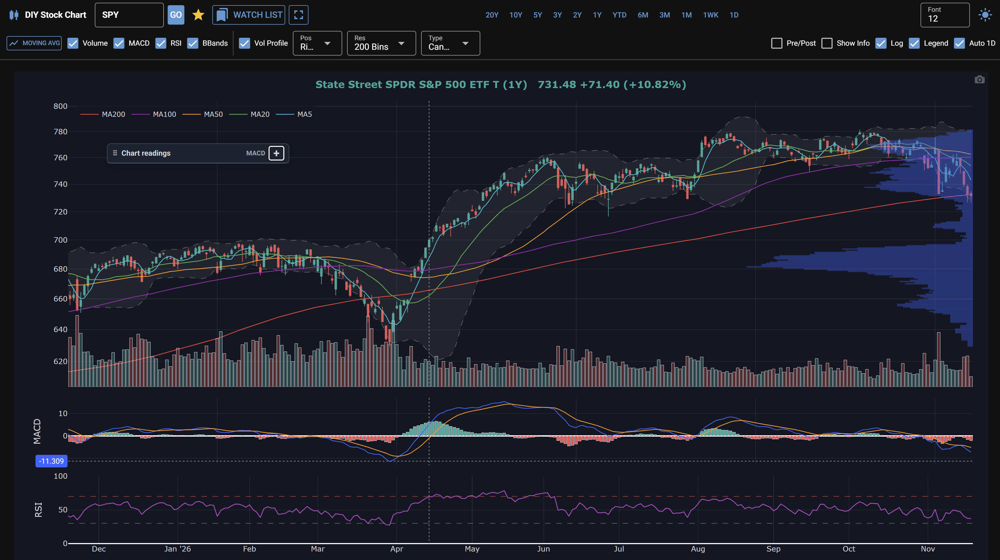
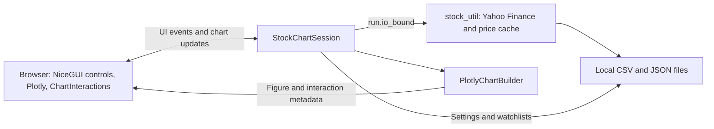
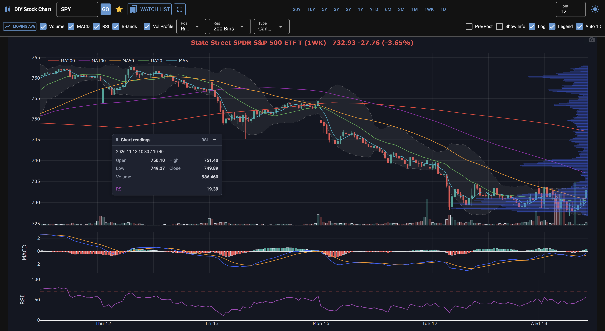
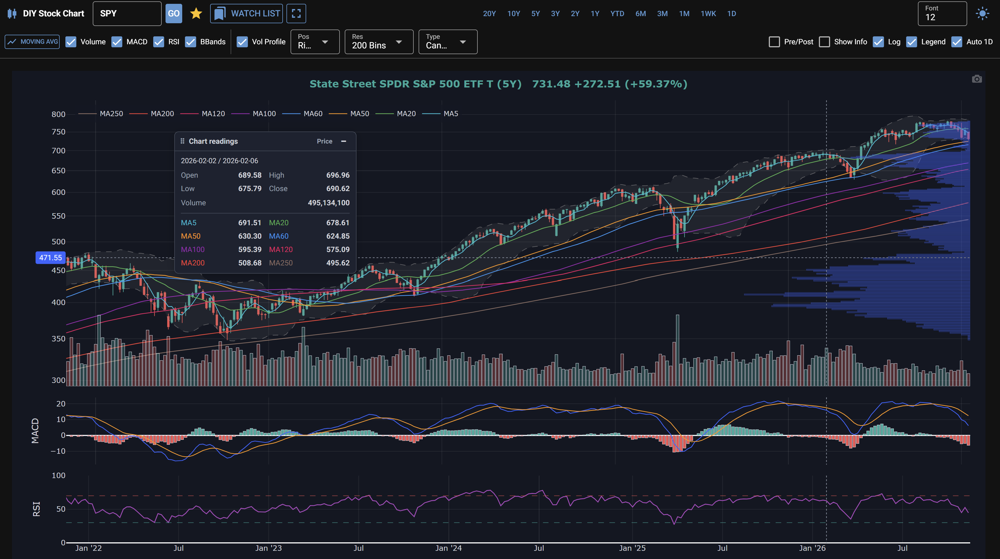
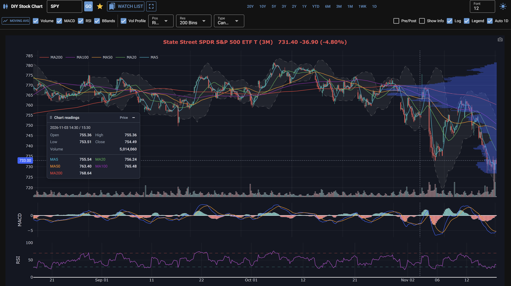
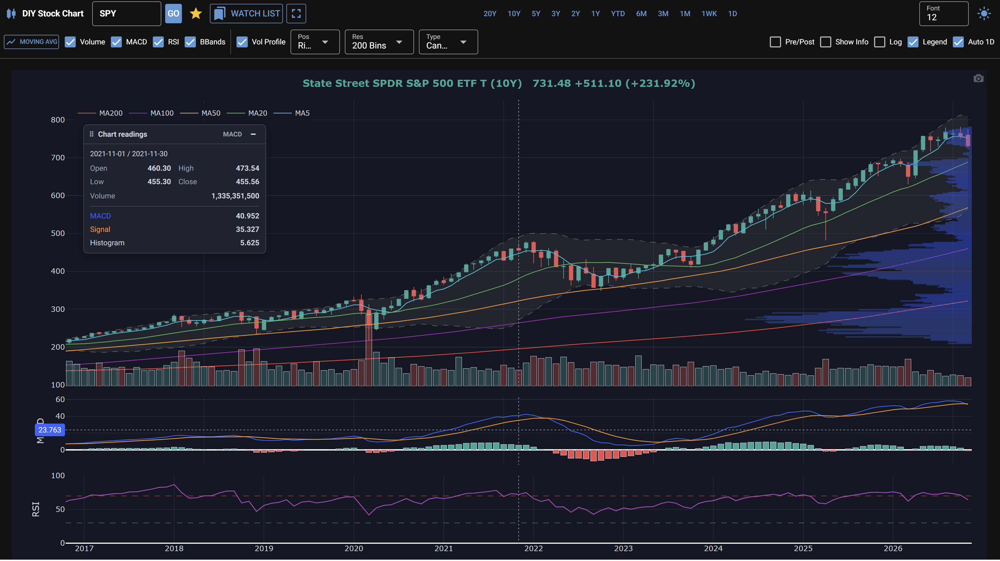
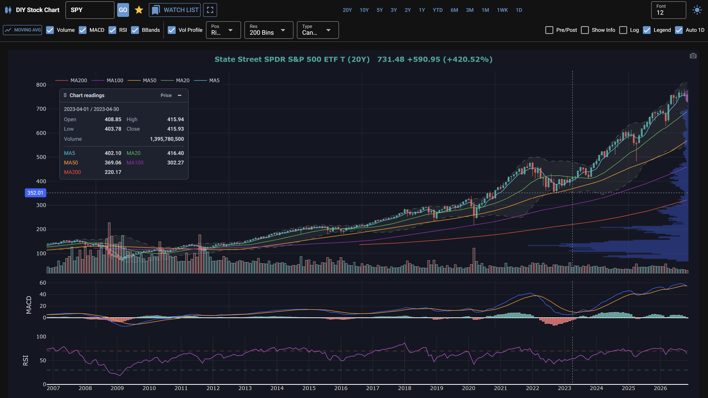
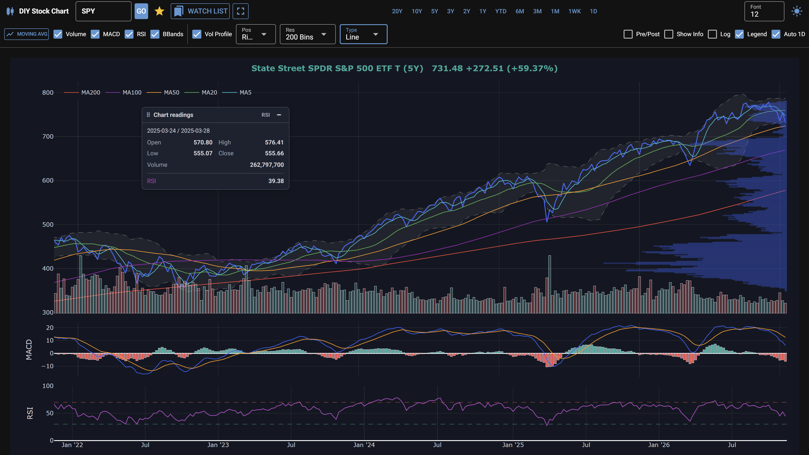

# DIY Stock Chart — Browser-Based Financial Analysis

An interactive stock and ETF charting application built with **Python, NiceGUI, and Plotly**. Run the Python app locally and explore Yahoo Finance price history, technical indicators, and volume profiles in your browser. Market data, watchlists, and preferences are stored locally in CSV and JSON files.

The major UI upgrade replaces the original Tkinter/Matplotlib interface with a browser workspace, synchronized crosshairs, movable chart readings, history panning, dark/light themes, and logarithmic prices. The project began through prompt-driven AI-assisted development with Antigravity; see the [AI Development Journey](ai-readme.md) for its evolution.

[](https://paypal.me/briannlhotmail/10) [](https://support.campfirecircle.org/diy/helping-the-kids-to-recover) [](https://give.sickkidsfoundation.com/fundraisers/brianli/healthy-kids)

**Documentation:** [Browser Architecture](design.md#5-browser-modernization-reference-design) · [Algorithm Deep-Dive](chart-app/algorithm.md) · [AI Development Journey](ai-readme.md)

> [!WARNING]
> **Data quality and trading risk:** This application uses the unofficial Yahoo Finance interface through `yfinance`. Quotes may be delayed, incomplete, or erroneous, and data availability varies by asset and interval. This tool is for educational and research purposes only and should not be used for real-time trading or financial decisions. The developers are not responsible for financial losses.



## Installation and launch

You need Python with `venv` and `pip`, a modern browser, and an internet connection to retrieve market data. Install the dependencies from the repository manifest.

1. Clone the repository and create a virtual environment:

   ```bash
   git clone https://github.com/higgsboson-io/diy-stock-chart-app.git
   cd diy-stock-chart-app
   python -m venv .venv
   ```

2. Activate the environment for your shell:

   **Windows PowerShell**

   ```powershell
   .\.venv\Scripts\Activate.ps1
   ```

   **Linux / macOS / WSL (Bash)**

   ```bash
   source .venv/bin/activate
   ```

3. Install dependencies and start the app:

   ```bash
   python -m pip install -r chart-app/requirements.txt
   python chart-app/app_stock_chart.py
   ```

The app starts a NiceGUI server on port **8080** and opens a browser automatically. You can also open [http://localhost:8080](http://localhost:8080). Keep the Python process running while using the chart; press **Ctrl+C** in its terminal to stop it.

The active dependencies are **NiceGUI, Plotly, yfinance, pandas, NumPy, pytz, and FinTA**, as listed in [requirements.txt](chart-app/requirements.txt). The browser app requires no Node.js build step or separate database. You can also launch `python app_stock_chart.py` from `chart-app/`; data paths are anchored to the application directory.

## Features

- **Twelve time windows:** Explore one trading session through twenty years, with interval selection and aggregation handled automatically.
- **Candle and line charts:** Switch between OHLC candles and closing-price lines, with linear or logarithmic price scales.
- **Eight moving averages:** Toggle SMA 5, 20, 50, 60, 100, 120, 200, and 250 individually. Add Bollinger Bands, MACD, and RSI as needed.
- **Volume analysis:** Overlay volume bars at the bottom of the price pane and place a 100-, 200-, or 400-bin volume profile on either edge. The profile follows the visible history window.
- **Synchronized inspection:** Hover over price, MACD, or RSI to inspect the same bar across panes. A movable, collapsible readings frame shows OHLCV and the active pane's indicator values.
- **Left/right chart scrolling:** Scroll left through older history and right toward the latest bars using horizontal dragging, touchpad scrolling, or **Shift + mouse wheel**. The visible bar count stays fixed, and price, MACD, volume, and profile ranges adjust to the viewport.
- **Intraday sessions:** Display regular or extended equity hours with session shading. Crypto, forex, and futures symbols use a calendar-day display model.
- **Gapless date axis:** Consecutive trading bars share a continuous axis, with date labels that prioritize month/year boundaries and reduce collisions.
- **Local persistence:** Incremental price caches, metadata sidecars, grouped watchlists, and chart preferences survive restarts.
- **Browser workspace:** Dark/light themes, adjustable chart fonts, fullscreen, chart image export, and a stock/ETF information card.

## Controls and interactions

| Control | Behavior |
| --- | --- |
| **Ticker / Go** | Enter a Yahoo Finance symbol such as `SPY`, `NVDA`, `BTC-USD`, or `CAD=X`, then press **Enter** or **Go**. |
| **Time buttons** | Select `1D`, `1WK`, `1M`, `3M`, `6M`, `YTD`, `1Y`, `2Y`, `3Y`, `5Y`, `10Y`, or `20Y`. Selecting a window returns to its latest data. |
| **Left/right scrolling** | Browse older or newer loaded data by dragging horizontally inside a chart pane, scrolling horizontally with a touchpad, or using **Shift + mouse wheel**. |
| **Type** | Select **Candle** or **Line**. |
| **Moving Avg** | Toggle each of the eight color-coded SMA lines. |
| **Volume / MACD / RSI / BBands** | Toggle the volume overlay, indicator panes, and Bollinger Bands. |
| **Vol Profile / Pos / Res** | Show or hide the profile, choose **Left** or **Right**, and select **100 Bins**, **200 Bins**, or **400 Bins**. |
| **Pre/Post** | For `1D` equities, switch between 09:30–16:00 and 04:00–20:00 Eastern. The control is disabled for assets classified as crypto, forex, or futures. |
| **Show Info** | Show a stock/ETF card above the chart with session statistics, valuation, dividends, earnings, or ETF profile fields when available. |
| **Log** | Switch the price axis to a logarithmic scale. MACD, RSI, and volume keep their own scales. |
| **Legend** | Show or hide the chart legend. |
| **Auto 1D** | Refresh the latest `1D` view every **60 seconds**. Refresh pauses in other windows, while loading, and while viewing older history. |
| **Font / theme icon** | Adjust chart/readings font size or switch between dark and light themes. |
| **Fullscreen icon** | Enter or exit browser fullscreen; **Esc** exits fullscreen. |
| **Camera icon** | Export the Plotly chart as an image. |
| **Star / Watch List** | Add or remove the current ticker, load a saved ticker, or open watchlist management. |

### Inspect a bar

Hover over any chart pane. The vertical crosshair follows the same bar across all enabled panes; the horizontal crosshair and left-axis value belong to the pane under the pointer. The **Chart readings** frame shows the bar's date or period range, open, high, low, close, and volume. Price hover adds enabled moving averages; MACD and RSI hover show their respective indicator readings.

Drag the readings frame by its header to reposition it, or focus the header and use the arrow keys. Use **− / +** to collapse or expand it. The separate **Show Info** card contains company/ETF fundamentals.

### Scroll left and right through history

The chart supports **left/right scrolling**: move the viewing window left to inspect older data, then right to return toward the latest bars. Click and drag horizontally inside any chart pane, scroll horizontally with a touchpad, or use **Shift + mouse wheel**.

Price, MACD, and RSI panes move together. The viewport keeps a fixed number of bars and stops at the available history boundaries. Indicators retain their preceding history as you scroll, and the volume profile updates for the visible window.

Return to the rightmost data to resume **Auto 1D** refresh. Clicking a time-window button or submitting a ticker with **Go / Enter** also resets the view to the latest data. Chart gestures are dedicated to horizontal history navigation; use the time-window buttons to change the displayed span.

### Manage watchlists

Click the empty star to add the current ticker to one or more lists using checkboxes, or create a list in the same dialog. Clicking a filled star removes that ticker from **all** lists.

Open **Watch List → Manage Watch Lists...** to create, rename, delete, or reorder groups, and add, remove, or reorder their tickers. Select a ticker from the Watch List menu to load its chart. Empty groups and custom ordering are retained in the watchlist CSV.

## Time windows and bar sizes

| Window | Download interval | Displayed bars |
| --- | --- | --- |
| `1D` | 1 minute | One-minute session grid |
| `1WK` | 5 minutes | 10-minute OHLCV bars |
| `1M`, `3M` | 1 hour | Hourly bars |
| `6M`, `1Y` | 1 day | Daily bars |
| `YTD` | 1 hour for the first 90 elapsed days of the year, then 1 day | Hourly or daily bars |
| `2Y` | 1 day | Groups of two consecutive trading bars |
| `3Y` | 1 day | Groups of three consecutive trading bars |
| `5Y` | 1 day | Weekly bars, starting Monday |
| `10Y`, `20Y` | 1 day | Monthly bars, starting on the first of the month |

Moving-average periods count **bars after resampling**: MA200 on a weekly chart spans 200 weekly bars. Resampling retains the current incomplete week or month and records period ranges for readings.

Intraday timestamps use **America/New_York**. The app displays assets classified as crypto, forex, or futures on a 00:00–23:59 calendar-day grid; actual trading schedules and data coverage depend on the instrument. For one-minute views, missing minutes between a session's first and last observed trades are drawn as flat candles with zero volume. Indicators are calculated before this display-only fill, and unobserved session edges remain empty.

The volume profile estimates volume by distributing each contributing raw bar's volume equally across the price bins spanning its low–high range. It is an OHLCV-based approximation of volume at price.

## Architecture and source layout

The Python controller owns each page's ticker, data, preferences, and viewport. Market-data/cache calls run through NiceGUI's `run.io_bound` worker pool. Python resamples the observed bars, calculates indicators, and builds Plotly figures. Browser JavaScript handles pointer tracking and immediate history gestures, then sends settled history positions back to Python.



| Module | Responsibility |
| --- | --- |
| [app_stock_chart.py](chart-app/app_stock_chart.py) | NiceGUI entry point, `StockChartSession`, toolbar, background fetches, settings, refresh, and history events. |
| [stock_util.py](chart-app/stock_util.py) | Yahoo Finance access, incremental cache, metadata, time-window mapping, resampling, and indicators. |
| [chart_plotly.py](chart-app/chart_plotly.py) | `PlotlyChartBuilder`: chart traces, pane layout, date labels, volume profile, axis ranges, and interaction metadata. |
| [chart_interactions.py](chart-app/chart_interactions.py), [JavaScript](chart-app/chart_interactions.js), [CSS](chart-app/chart_interactions.css) | NiceGUI component bridge, synchronized crosshairs, movable readings, and history panning. |
| [info_panel.py](chart-app/info_panel.py) | Stock/ETF fundamentals and session-statistics card. |
| [watchlist.py](chart-app/watchlist.py) | `WatchListManager` persistence and `WatchListDialogs` management UI. |
| [debug_price.py](chart-app/debug_price.py) | Standalone data-download and gap-analysis CLI. |
| [chart_drawing.py](chart-app/chart_drawing.py) | Retained Matplotlib renderer from the original desktop app; the current entry point uses `chart_plotly.py`. |

See [design.md, section 5](design.md#5-browser-modernization-reference-design) for detailed browser architecture and interaction contracts. The design document also retains the desktop architecture and earlier migration notes. Its references to a separate `gui-stock-chart/app/` workspace and an unpublished browser rewrite predate this source upgrade; the browser implementation is now under `chart-app/` in this checkout.

FinTA supplies MACD, RSI, and Bollinger Bands, with pandas implementations used as a fallback. SMAs always use pandas rolling means. Formula and initialization details are covered in the [Algorithm Deep-Dive](chart-app/algorithm.md).

## Local files and caching

The app creates these files beneath `chart-app/` as needed:

| Path | Contents and behavior |
| --- | --- |
| `chart-app/csv/{TICKER}_{interval}_{date}.csv` | OHLCV price cache. One-minute requests refresh a five-day buffer and merge cached bars. Other intervals append updates from the last cached date and replace overlapping timestamps. |
| `chart-app/csv/{TICKER}_info.csv` | Company/ETF metadata sidecar with a 30-day freshness check. Missing required fields trigger a refresh. |
| `chart-app/conf/settings.json` | Indicator toggles, time window, chart type, profile options, log scale, theme, font size, and refresh preferences. |
| `chart-app/conf/watchlist.csv` | Ordered groups and tickers with columns `WatchList,Ticker,Name`. |
| `chart-app/csv/debug_*.csv` | Raw downloads saved by the diagnostic CLI. |

On startup, cache cleanup removes CSV files older than seven days by modification time, preserving metadata sidecars. Price history can be downloaded again; back up `conf/` to retain watchlists and preferences.

Each browser page has its own in-memory chart session, while caches, saved settings, and watchlists use shared files in the application directory. The app is intended for local personal use; saved files are shared across tabs.

## Screenshots

### Weekly intraday detail

The `1WK` view aggregates five-minute source data into ten-minute candles.



### Crosshairs and movable readings

The readings frame displays period dates, OHLCV, and enabled moving averages alongside synchronized indicator panes.



### Volume profile and overlay

Volume bars share the price pane, while the profile summarizes the contributing raw bars for the visible period.



### Long-term views

The `10Y` and `20Y` views aggregate daily history into monthly candles.





### Line chart

Switch **Type** to **Line** for a close-price view with the same indicators and history controls.



Additional examples: [six-month view](chart-screen/6-month.png) · [five-year view](chart-screen/5-year.png).

## Data diagnostics

For a direct provider download and heuristic gap report, run this from the repository root:

```bash
python chart-app/debug_price.py SPY 1d 2025-01-01
```

Arguments are `TICKER INTERVAL START_DATE`. The script prints statistics and suspected gaps and saves raw data under `chart-app/csv/debug_*.csv`. Its gap checks use market-hours heuristics rather than an exchange holiday calendar.

## License and author

[MIT License](LICENSE) · Brian Li and Higgs Boson Inovations.

[](https://paypal.me/briannlhotmail/10) [](https://support.campfirecircle.org/diy/helping-the-kids-to-recover) [](https://give.sickkidsfoundation.com/fundraisers/brianli/healthy-kids)
